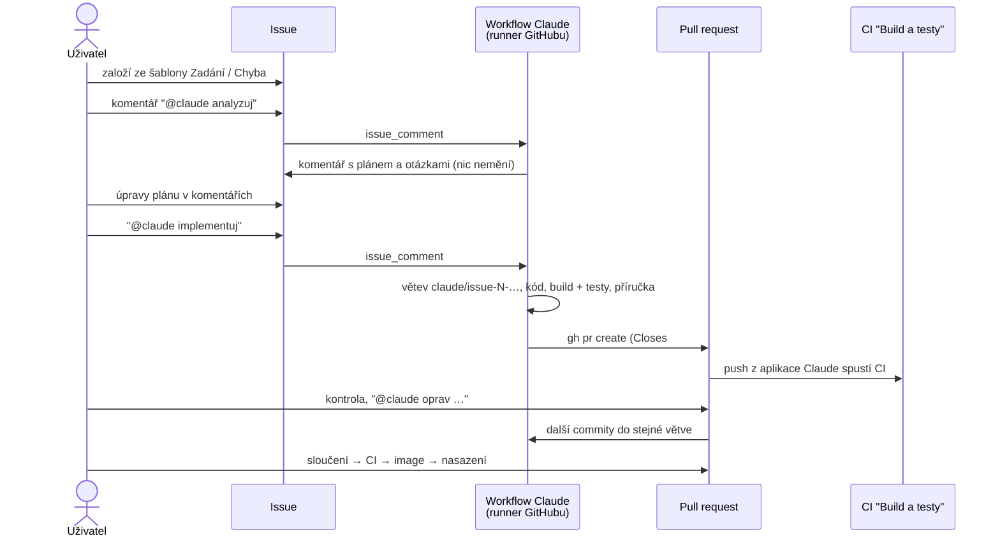

> **V jedné větě:** Zadání se píše do **issue**, komentář `@claude analyzuj` přinese plán, `@claude implementuj`
> z něj udělá **pull request** – ten projde stejným CI a sloučí ho (a tím nasadí) vždy **člověk**.

Kód: [claude.yml](code:.github/workflows/claude.yml), šablony [Zadání](code:.github/ISSUE_TEMPLATE/zadani.yml)
a [Chyba](code:.github/ISSUE_TEMPLATE/chyba.yml), pravidla pro agenta v [CLAUDE.md](code:CLAUDE.md) (sekce *Práce v GitHub Issues*).

Přirovnání: issue je zadání pro kolegu. Označíte ho (`@claude`), on si stáhne projekt, odpoví komentářem
a hotovou práci odevzdá jako PR ke kontrole. Do `main` sám nic nedá.

## Tok práce

| Krok | Kdo | Výsledek |
| --- | --- | --- |
| Zadání | člověk | issue ze šablony (co a proč, akceptační kritéria, oblast) |
| Analýza (`@claude analyzuj`) | agent | komentář: dotčené moduly a soubory, zprávy, migrace, Journeys, oprávnění, příručka, rizika, otázky. **Žádná změna.** |
| Souhlas (`@claude implementuj`) | člověk | odpovídá pravidlu „nejdřív plán, pak změny“ z práce na PC |
| Vývoj | agent | větev `claude/issue-N-…`, commity, `dotnet build` + `dotnet test`, PR s `Closes #N` |
| Kontrola | člověk (+ agent na `@claude` v PR) | připomínky = další commity |
| Sloučení a nasazení | **jen člověk** | běžná [CD](cd.md); ověření v produkci také člověk |

## Přihlášení a náklady

- Akce `anthropics/claude-code-action` (verze `@v1`) spustí na runneru Claude Code – stejný nástroj jako na PC.
- Přihlašuje se **tokenem předplatného Claude** v secretu repozitáře `CLAUDE_CODE_OAUTH_TOKEN`
  (dlouhodobý token, vytvoří ho `claude setup-token` na PC). Spotřeba jde do limitů předplatného, API klíč se neplatí.
- Runner GitHubu je pro veřejný repozitář zdarma. Job má limit 60 minut a 120 kroků agenta.
- Commity a PR dělá **GitHub aplikace Claude** (nainstalovaná do repozitáře). Proč ne `GITHUB_TOKEN`: změny jím
  provedené záměrně nespouští další workflow – PR by neměl CI a nešel by sloučit.

## Bezpečnost (veřejný repozitář)

| Riziko | Ochrana |
| --- | --- |
| Cizí člověk napíše `@claude` | job se spustí jen pro `OWNER`/`MEMBER`/`COLLABORATOR` (podmínka `if`), akce navíc ověří právo zápisu |
| Agent sáhne na produkci | job **nemá** environment `production` – žádné secrets aplikace ani nasazení, žádný Tailscale; environment pouští jen větev `main` (krok 3 nastavení) |
| Agent zapíše do `main` | ruleset `main-protection` – jen PR se zeleným CI ([Repozitář](repozitar.md)) |
| Agent změní workflow | pravidlo v CLAUDE.md; změna je vidět v PR, slučuje člověk; `deploy` běží jen z `main` |
| Podvržené instrukce v textu issue | spouští jen vlastník; text cizích komentářů je pro agenta jen data (CLAUDE.md) |
| Únik tajné hodnoty | šablony issues upozorňují; secret scanning + push protection hlídají i commity agenta |
| Agent spustí něco nečekaného | `--allowedTools`: jen čtení/úpravy souborů, `dotnet build/test/ef`, git a `gh pr`/`gh issue view` |

## Co agent neumí

- **Nevidí běžící aplikaci** – nemá prohlížeč, AppHost ani RabbitMQ. Testy (včetně PostgreSQL přes Testcontainers)
  spustí, ověření v prohlížeči a na telefonu zůstává na člověku – proto PR obsahuje „co vyzkoušet ručně“.
- **Každý běh začíná s čistou hlavou** – zná jen issue, komentáře, PR a repozitář (včetně CLAUDE.md). Čím lepší
  zadání a akceptační kritéria, tím lepší výsledek.
- Velká funkce = rozdělit do více issues (jako kroky roadmap) – jeden běh má časový limit.
- **Nemůže pushnout změnu `.github/workflows/`** (GitHub aplikace nemá oprávnění *workflows*) – navrhne ji v PR nebo komentáři, do větve ji dá člověk (ověřeno u issue #92).
- Kroky v konzolích (Stripe, Google, Wedos, OCI) a nastavení secrets dělá dál člověk.

## Nastavení (jednou)

1. Nainstalovat GitHub aplikaci **Claude** do repozitáře `ftichy/MiniShop` (jen tento repozitář).
2. Na PC `claude setup-token` → hodnotu vložit do *Settings → Secrets and variables → Actions* jako
   `CLAUDE_CODE_OAUTH_TOKEN` (secret **repozitáře**, ne environmentu `production`).
3. Environment `production` → *Deployment branches* = jen `main`.
4. Štítky `zadani` a `chyba` (šablony je přiřazují).

Výměna tokenu: [docs/secrets.md](code:docs/secrets.md) R14.

## Na internetu

- [Claude Code GitHub Actions](https://docs.anthropic.com/en/docs/claude-code/github-actions)
- [anthropics/claude-code-action](https://github.com/anthropics/claude-code-action)
- [GitHub: Issue forms](https://docs.github.com/communities/using-templates-to-encourage-useful-issues-and-pull-requests/syntax-for-issue-forms)
