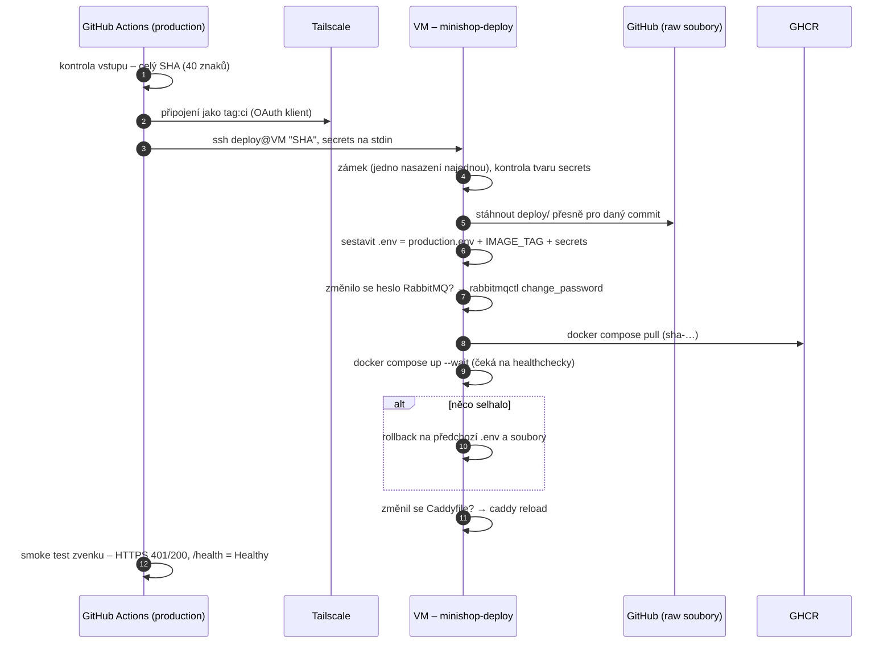

> **V jedné větě:** Po úspěšném CI na `main` se runner GitHubu připojí do soukromé sítě **Tailscale**, přes SSH
> pošle VM jen **SHA commitu** a skript `minishop-deploy` na VM udělá zbytek – včetně návratu při chybě.

Kód: [deploy.yml](code:.github/workflows/deploy.yml), [deploy.sh](code:deploy/deploy.sh)

## Průběh

## Bezpečnost nasazení

| Opatření | Proč |
| --- | --- |
| **SSH jen přes Tailscale**, port 22 v cloudu zavřený | server není z internetu dostupný pro SSH útoky |
| Runner se do Tailscale připojí dočasně jako `tag:ci` | ACL mu povolí jen port 22 na VM |
| Uživatel **`deploy`** s **vynuceným příkazem** (`command="/usr/local/bin/minishop-deploy"` v `authorized_keys`) | klíč z GitHubu neumí nic jiného než nasadit commit – ani otevřít shell |
| Vstup = jen SHA (regulární výraz) | žádné mezery, středníky ani cesty – nejde podstrčit příkaz |
| Pevný otisk serveru (`DEPLOY_KNOWN_HOSTS`) | kdyby se za adresou ozval jiný server, SSH odmítne spojení |
| **Secrets na stdin**, ne v příkazu | nejsou vidět v logu ani v seznamu procesů; GitHub je v logu zamaskuje |
| Skript přijme jen známé klíče v očekávaném tvaru | do `.env` se nedostane nic neočekávaného |
| `concurrency: production`, bez přerušení | nikdy dvě nasazení najednou, rozběhnuté se nedá zrušit v půlce |

## Rollback

- **Automaticky**: `deploy.sh` si před nasazením uloží předchozí `.env` a soubory do `previous/`. Když `pull` nebo
  `up --wait` selže, vrátí je a spustí předchozí verzi – bez spojení s GitHubem.
- **Ručně**: GitHub → Actions → **Deploy** → *Run workflow* → SHA staršího commitu. Nebo na VM
  `sudo -u deploy minishop-deploy <SHA>`.

## Změna samotného deploy.sh

Skript na VM leží jako `/usr/local/bin/minishop-deploy` (vlastník root) – nestahuje se sám. Změnu je potřeba na VM
nainstalovat **ručně a před sloučením**, pokud na ní závisí její vlastní nasazení. Nová VM ho dostane z cloud-init.

## Proč takhle

- **Continuous Deployment bez ručního schválení** – výukový projekt, testy prošly. Schvalování (*Required reviewers*)
  jde v environmentu zapnout kdykoli – pak je to Continuous Delivery.
- **Konfigurace z GitHubu podle commitu** – na VM vždy běží přesně ta konfigurace, která patří k image. Funguje, protože
  je repozitář veřejný.
- **Rollback na VM, ne v pipeline** – skript zná předchozí stav a funguje i bez GitHubu.
- **Smoke test zvenku** – ověří DNS, certifikát, Caddy a zdraví obou služeb tak, jak je vidí uživatel.

## Na internetu

- [GitHub: Environments](https://docs.github.com/actions/managing-workflow-runs-and-deployments/managing-deployments/managing-environments-for-deployment)
- [Tailscale GitHub Action](https://tailscale.com/kb/1276/tailscale-github-action)
- [OpenSSH: authorized_keys – command a restrict](https://man.openbsd.org/sshd.8#AUTHORIZED_KEYS_FILE_FORMAT)
