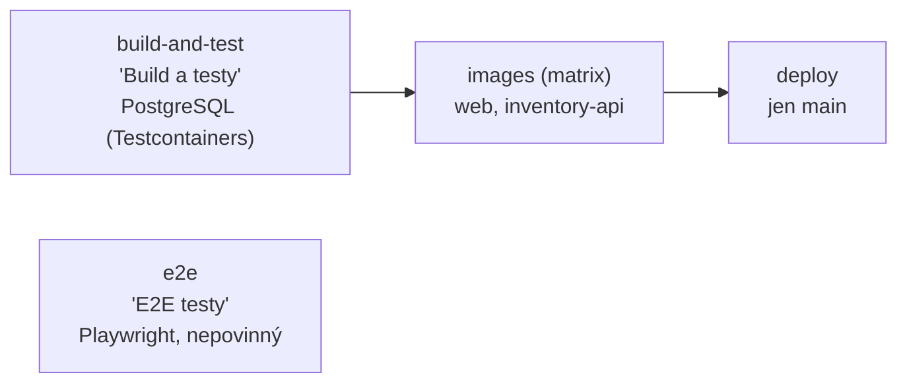

> **V jedné větě:** Při každém PR a pushi do `main` GitHub na čistém Linuxu sestaví řešení, spustí všechny testy
> a sestaví Docker image; z `main` je navíc uloží do **GitHub Container Registry**.

Kód: [ci.yml](code:.github/workflows/ci.yml)

## Joby



| Job | Co dělá | Detaily |
| --- | --- | --- |
| **Build a testy** | `restore` → `build -c Release` → `test` (nad PostgreSQL – Testcontainers spustí `postgres:18-alpine` v Dockeru runneru, [Databáze – testy](../architektura/databaze.md)) | cache NuGet balíčků (klíč = otisk `.csproj`, `.props`, `global.json`), výsledky testů jako artefakt `.trx` (14 dní) |
| **Image web / inventory-api** | Docker Buildx | PR: jen x86, nic se neukládá (rozbitý Dockerfile se pozná před sloučením). `main`: **amd64 + arm64** (QEMU) a push do GHCR |
| **Nasazení** | volá `deploy.yml` | jen na `main`, až po úspěšných image – viz [CD](cd.md) |
| **E2E testy** | celý e-shop v Compose + Playwright (Chromium) | PR i `main`, běží vedle ostatních jobů; **není povinný check** a nasazení neblokuje – viz sekce „E2E testy v prohlížeči“ níže |

## Důležitá nastavení

| Nastavení | Proč |
| --- | --- |
| `runs-on: ubuntu-24.04` (ne `latest`) | prostředí se nezmění pod rukama |
| .NET SDK podle `global.json` | CI i PC používají stejnou verzi |
| `permissions: contents: read`, zápis do registry jen job `images` | nejmenší oprávnění |
| `concurrency` – nový push do PR zruší starý běh; na `main` se nic neruší | výsledek starého commitu nikoho nezajímá, rozběhnuté nasazení se ale musí dokončit |
| push na `main`: `paths` bez `docs/**` a `*.md`, **kromě `docs/prirucka/**`** | čistě dokumentační změna (roadmapy, souhrny kroků) nic nestaví; příručka je ale součást image Webu, takže její změna se nasadí |
| U PR se nefiltruje | povinný check musí dorazit u každého PR, jinak by nešel sloučit |
| `FROM --platform=$BUILDPLATFORM` v Dockerfile | .NET se kompiluje nativně, emuluje se jen závěrečná fáze ARM image – build je rychlý |
| Cache vrstev Dockeru v GitHub Actions (`type=gha`) | další build je rychlejší |

## Image v GHCR

| Image | Štítky |
| --- | --- |
| `ghcr.io/ftichy/minishop-web` | `sha-<7 znaků commitu>`, `latest` |
| `ghcr.io/ftichy/minishop-inventory-api` | `sha-<7 znaků commitu>`, `latest` |

- Na VM se nasazuje vždy konkrétní **`sha-…`**, nikdy `latest` – je jasné, co běží, a rollback je jen jiný štítek.
- Balíčky jsou **veřejné** (zdědí viditelnost repozitáře přes label `org.opencontainers.image.source`) – VM je stáhne
  bez přihlášení.
- Do GHCR se přihlašuje `GITHUB_TOKEN`, který GitHub vytvoří pro každý běh a po něm zanikne.

## Použité akce

`actions/checkout`, `actions/setup-dotnet`, `actions/cache`, `actions/upload-artifact`, `docker/setup-qemu-action`,
`docker/setup-buildx-action`, `docker/login-action`, `docker/metadata-action`, `docker/build-push-action`
(a v CD `tailscale/github-action`, v agentovi `anthropics/claude-code-action` – [Agent Claude v issues](agent.md)).
Verze hlídá Dependabot.

## E2E testy v prohlížeči

Přirovnání: ostatní testy kontrolují každý díl auta zvlášť na stole, E2E test je zkušební jízda celým autem.
Projekt [tests/MiniShop.E2E](code:tests/MiniShop.E2E/MiniShop.E2E.csproj) (xUnit + **Microsoft.Playwright**, jen Chromium)
ovládá skutečný prohlížeč nad skutečně spuštěnou aplikací a odhalí rozbitou nákupní cestu před sloučením PR.

| Scénář | Co ověřuje |
| --- | --- |
| Nákup kartou | registrace → potvrzení e-mailu → výloha → košík → pokladna (kurýr, adresa) → platba na simulované bráně → detail ve stavu **Potvrzená** |
| Expedice | admin zabalí → odešle (dopravce + číslo zásilky) → doručeno; zákazník vidí **Doručená** |
| Mobil | viewport 390×844: menu ☰, filtry v panelu, spodní lišta košíku, pokladna |

**Jak job běží** (`e2e` v [ci.yml](code:.github/workflows/ci.yml)):

1. Postaví image Webu a skladu (stejná cache vrstev jako job *Image*) a spustí je přes
   [compose.yaml](code:deploy/compose.yaml) + [compose.e2e.yaml](code:deploy/compose.e2e.yaml) – PostgreSQL, RabbitMQ, Inventory.Api, Web
   a **Mailpit** (`axllent/mailpit`, cvičná pošta).
2. Hesla pro Compose a pro admina vygeneruje za běhu (`openssl rand`) – **nic tajného v gitu ani v GitHub secrets**.
   Admina založí příkazem `create-admin` (heslo z roury, v logu zamaskované).
3. Potvrzovací odkaz z e-mailu test přečte přes API Mailpitu – aplikace kvůli tomu nemá žádná zadní vrátka,
   jen místo Gmailu mluví s jiným SMTP serverem. `compose.e2e.yaml` také zvedne limit formulářů účtu (testy běží z jedné IP).
4. Při selhání nahraje artefakt **e2e-artifacts**: Playwright trace (`*.trace.zip` – otevřít na
   [trace.playwright.dev](https://trace.playwright.dev/)), snímek stránky a logy služeb.

**Čekání:** sága potvrdí objednávku za ~4–8 s, katalog se plní ~2–4 s. Testy proto stránku obnovují s limitem 40 s
(`ShopFlow.ReloadUntilAsync`), nikdy nespí napevno. **Selektory** jdou přes `data-track` a ID polí (na nich stojí
[Journeys](../toky/prubeh-formulare.md), takže se nemění), ne přes CSS třídy.

**Lokálně:**

```bash
cd deploy                       # jednou: cp .env.example .env
docker compose -f compose.yaml -f compose.e2e.yaml up -d --build --wait
printf 'Heslo-pro-e2e-123\nHeslo-pro-e2e-123\n' | docker compose -f compose.yaml -f compose.e2e.yaml exec -T web \
  dotnet MiniShop.Web.dll create-admin --email e2e-admin@example.test
cd ..
dotnet build tests/MiniShop.E2E
pwsh tests/MiniShop.E2E/bin/Debug/net10.0/playwright.ps1 install chromium     # jednou
E2E_BASE_URL=http://localhost:8080 E2E_MAILPIT_URL=http://localhost:8025 \
E2E_ADMIN_EMAIL=e2e-admin@example.test E2E_ADMIN_PASSWORD=Heslo-pro-e2e-123 dotnet test tests/MiniShop.E2E
```

Adresa musí být přesně `localhost` (přihlašovací cookie je `Secure`, jen tam ji Chromium pustí i na HTTP).
**Bez `E2E_BASE_URL` se E2E testy přeskočí** – `dotnet test MiniShop.slnx` bez spuštěné aplikace tedy nezčervená.

## Na internetu

- [GitHub Actions: syntaxe workflow](https://docs.github.com/actions/writing-workflows/workflow-syntax-for-github-actions)
- [GitHub Container Registry](https://docs.github.com/packages/working-with-a-github-packages-registry/working-with-the-container-registry)
- [Docker: Multi-platform builds](https://docs.docker.com/build/building/multi-platform/)
