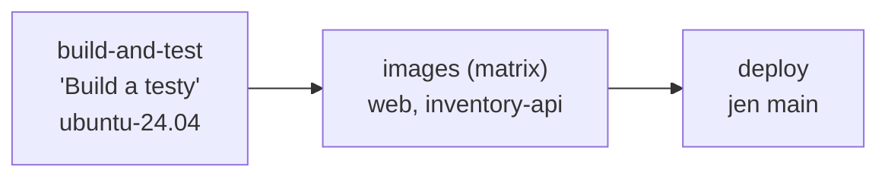

> **V jedné větě:** Při každém PR a pushi do `main` GitHub na čistém Linuxu sestaví řešení, spustí všechny testy
> a sestaví Docker image; z `main` je navíc uloží do **GitHub Container Registry**.

Kód: [ci.yml](code:.github/workflows/ci.yml)

## Joby

| Job | Co dělá | Detaily |
| --- | --- | --- |
| **Build a testy** | `restore` → `build -c Release` → `test` | cache NuGet balíčků (klíč = otisk `.csproj`, `.props`, `global.json`), výsledky testů jako artefakt `.trx` (14 dní) |
| **Image web / inventory-api** | Docker Buildx | PR: jen x86, nic se neukládá (rozbitý Dockerfile se pozná před sloučením). `main`: **amd64 + arm64** (QEMU) a push do GHCR |
| **Nasazení** | volá `deploy.yml` | jen na `main`, až po úspěšných image – viz [CD](cd.md) |

## Důležitá nastavení

| Nastavení | Proč |
| --- | --- |
| `runs-on: ubuntu-24.04` (ne `latest`) | prostředí se nezmění pod rukama |
| .NET SDK podle `global.json` | CI i PC používají stejnou verzi |
| `permissions: contents: read`, zápis do registry jen job `images` | nejmenší oprávnění |
| `concurrency` – nový push do PR zruší starý běh; na `main` se nic neruší | výsledek starého commitu nikoho nezajímá, rozběhnuté nasazení se ale musí dokončit |
| push na `main`: `paths` bez `docs/**` a `*.md`, **kromě `docs/prirucka/**`** | čistě dokumentační změna (roadmapy, souhrny kroků) nic nestaví; příručka je ale součást image Webu, takže její změna se nasadí |
| U PR se nefiltruje | povinný check musí dorazit u každého PR, jinak by nešel sloučit |
| `FROM --platform=$BUILDPLATFORM` v Dockerfile | .NET se kompiluje nativně, emuluje se jen závěrečná fáze ARM image – build je rychlý |
| Cache vrstev Dockeru v GitHub Actions (`type=gha`) | další build je rychlejší |

## Image v GHCR

| Image | Štítky |
| --- | --- |
| `ghcr.io/ftichy/minishop-web` | `sha-<7 znaků commitu>`, `latest` |
| `ghcr.io/ftichy/minishop-inventory-api` | `sha-<7 znaků commitu>`, `latest` |

- Na VM se nasazuje vždy konkrétní **`sha-…`**, nikdy `latest` – je jasné, co běží, a rollback je jen jiný štítek.
- Balíčky jsou **veřejné** (zdědí viditelnost repozitáře přes label `org.opencontainers.image.source`) – VM je stáhne
  bez přihlášení.
- Do GHCR se přihlašuje `GITHUB_TOKEN`, který GitHub vytvoří pro každý běh a po něm zanikne.

## Použité akce

`actions/checkout`, `actions/setup-dotnet`, `actions/cache`, `actions/upload-artifact`, `docker/setup-qemu-action`,
`docker/setup-buildx-action`, `docker/login-action`, `docker/metadata-action`, `docker/build-push-action`
(a v CD `tailscale/github-action`). Verze hlídá Dependabot.

## Na internetu

- [GitHub Actions: syntaxe workflow](https://docs.github.com/actions/writing-workflows/workflow-syntax-for-github-actions)
- [GitHub Container Registry](https://docs.github.com/packages/working-with-a-github-packages-registry/working-with-the-container-registry)
- [Docker: Multi-platform builds](https://docs.docker.com/build/building/multi-platform/)
