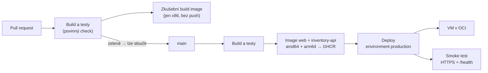

> **V jedné větě:** Každá změna jde přes **pull request**, kde ji **CI** otestuje; po sloučení do `main` se sama
> sestaví do image a **nasadí do cloudu**. Nic se nedělá ručně na serveru.

## Pipeline

| Stránka | Obsah |
| --- | --- |
| [Repozitář a ochrana](repozitar.md) | veřejný repozitář, ruleset `main-protection`, secret scanning, Dependabot |
| [CI – build, testy, image](ci.md) | workflow `ci.yml`, cache, artefakty, multi-arch image, GHCR |
| [CD – nasazení](cd.md) | workflow `deploy.yml`, Tailscale, vynucený příkaz, `deploy.sh`, rollback |
| [Secrets a konfigurace](secrets.md) | kde leží tajné hodnoty, jak se dostanou na VM a jak se mění |

## Proč GitHub Actions

- Kód už na GitHubu je – žádná další služba ani účet.
- Pro veřejný repozitář zdarma a bez limitu minut; registry (GHCR) také.
- Workflow jsou YAML v repozitáři – mění se stejně jako kód, přes PR.

Alternativy: GitLab CI, Azure DevOps, Jenkins (vlastní server). Pro projekt na GitHubu nedávají smysl.

## Na internetu

- [GitHub Actions – dokumentace](https://docs.github.com/actions)
- [Martin Fowler: Continuous Integration](https://martinfowler.com/articles/continuousIntegration.html)
