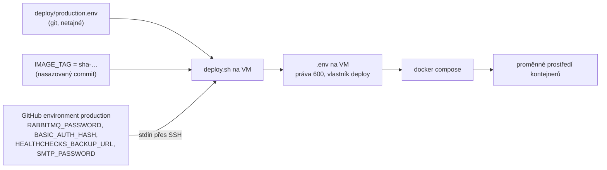

> **V jedné větě:** Netajná konfigurace produkce je v gitu (`deploy/production.env`), tajné hodnoty jen v GitHub
> environmentu **`production`**; při každém nasazení z nich `deploy.sh` sestaví na VM soubor `.env`.

## Tok konfigurace

- `.env` na VM se **pokaždé sestaví znovu** – ruční změny v něm nepřežijí další nasazení. Změna konfigurace = PR.
- Aplikace čte všechno z **proměnných prostředí** (`ConnectionStrings__messaging`, `Documentation__Commit`…) – stejný
  image běží lokálně i v cloudu ([12-factor](https://12factor.net/config)).

## Secrets

| Secret | K čemu | Kde |
| --- | --- | --- |
| `RABBITMQ_PASSWORD` | heslo účtu `minishop` v RabbitMQ | GitHub `production` → `.env` na VM |
| `BASIC_AUTH_HASH` | bcrypt otisk hesla pro zámek v Caddy | GitHub `production` → `.env` na VM |
| `HEALTHCHECKS_BACKUP_URL` | kam noční záloha hlásí průběh (volitelný) | GitHub `production` → `.env` na VM |
| `SMTP_PASSWORD` | heslo aplikace Gmailu pro odesílání e-mailů ([E-maily](../architektura/emaily.md)); volitelný | GitHub `production` → `.env` na VM |
| `DEPLOY_SSH_KEY` | soukromý klíč pro spuštění `minishop-deploy` | GitHub `production` |
| `TS_OAUTH_CLIENT_ID`, `TS_OAUTH_SECRET` | připojení runneru do Tailscale | GitHub `production` |
| `GITHUB_TOKEN` | push image do GHCR | vytváří ho GitHub pro každý běh |
| API klíč `minishop-automation`, klíč ke state | OpenTofu a OCI CLI | jen PC správce (`~/.oci/`) |

Proměnné (netajné) v environmentu: `DEPLOY_HOST` (adresa VM v Tailscale), `DEPLOY_KNOWN_HOSTS` (otisk serveru).

Úplný registr včetně postupů výměny: [docs/secrets.md](code:docs/secrets.md). **Nový secret = nový řádek tam.**

## Pravidla

1. **Nikdy v gitu** (ani v historii) – hlídá secret scanning + push protection. Repozitář je veřejný.
2. **Nejmenší oprávnění** – každý secret jen tam, kde je potřeba (např. VM nemá žádný klíč k úložišti záloh,
   používá identitu instance).
3. **Každý jde vyměnit bez přestavby serveru.** Příklad – heslo RabbitMQ: změnit secret → spustit Deploy. `deploy.sh`
   nejdřív heslo vymění v běžícím RabbitMQ (`rabbitmqctl change_password`), pak teprve restartuje služby.

## Nový secret aplikace

1. `deploy.yml` – přidat do `env` a do `printf` posílaného na stdin.
2. `deploy.sh` – nový `case` s kontrolou tvaru hodnoty a zápis do `.env`.
3. `compose.yaml` – předat službě; do `deploy/.env.example` vzorovou hodnotu.
4. Řádek v [docs/secrets.md](code:docs/secrets.md).

## Na internetu

- [GitHub: Secrets v Actions](https://docs.github.com/actions/security-for-github-actions/security-guides/using-secrets-in-github-actions)
- [The Twelve-Factor App: Config](https://12factor.net/config)
- [OWASP: Secrets Management Cheat Sheet](https://cheatsheetseries.owasp.org/cheatsheets/Secrets_Management_Cheat_Sheet.html)
