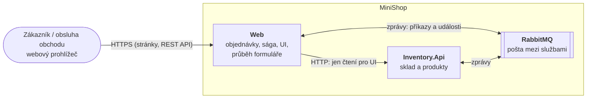

> **V jedné větě:** MiniShop je malý e-shop (produkty, sklad, objednávky). Jeho hlavním cílem není prodávat,
> ale **ukázat na skutečném kódu**, jak se staví aplikace řízená událostmi (EDA) – od první doménové události
> až po samostatné služby, které spolu mluví přes message broker a běží v cloudu.

## Jak tuhle dokumentaci číst

Dokumentace je jako mapa s lupou. Na každé úrovni vidíte celek a **kliknutím se přiblížíte**:

1. **Celkový přehled** (tato stránka): kdo MiniShop používá a z jakých velkých částí se skládá.
2. **Služby a kontejnery**: jaké procesy běží a jak spolu mluví.
3. **Moduly a komponenty**: co je uvnitř jedné služby.
4. **Kód**: odkazy `</>` vedou přímo na soubory na GitHubu.

Toto dělení vychází z [modelu C4](https://c4model.com/) (Context → Containers → Components → Code).
Uzly v diagramech jsou **klikací** – kurzor se nad nimi změní na ruku.

## Big picture

Co se tu děje, když si zákazník objedná:

1. **Web** přijme objednávku, uloží ji jako *čekající* a odpoví hned (HTTP 202) – na sklad nečeká.
2. Uloží zároveň zprávu „zarezervuj zboží“, kterou za chvíli doručí přes **RabbitMQ** skladu.
3. **Inventory.Api** zboží zarezervuje (nebo ne) a odpoví zprávou.
4. Web podle odpovědi objednávku **potvrdí**, nebo **zamítne**. Celý proces řídí [sága](eda/saga.md).

Podrobně krok za krokem: [Vytvoření objednávky](toky/vytvoreni-objednavky.md).

## Proč je to postavené právě takhle

E-shop by šel napsat jako jedna aplikace, která při objednávce rovnou odečte sklad. Funguje to – dokud
je všechno v jedné databázi a jednom procesu. MiniShop ukazuje, co dělat, když tomu tak **není**:

| Problém | Řešení v MiniShopu | Kde se o tom dočtete |
| --- | --- | --- |
| Objednávky nemají znát vnitřek skladu | Moduly s vlastní databází, komunikace jen zprávami | [Moduly](architektura/moduly/index.md) |
| Uložit data a odeslat zprávu „najednou“ | Outbox – zpráva se uloží v téže transakci | [Outbox](eda/outbox.md) |
| Zpráva může přijít dvakrát | Inbox – každá se zpracuje jen jednou | [Inbox](eda/inbox.md) |
| Transakce přes dvě databáze neexistuje | Sága s kompenzací | [Sága](eda/saga.md) |
| Sklad může na chvíli vypadnout | Broker zprávy podrží, sága má timeout | [Broker](eda/broker.md) |
| Kde se objednávka zasekla? | Trasování přes služby i zprávy | [Observabilita](eda/observabilita.md) |

## Technologie v kostce

ASP.NET Core (.NET 10), EF Core + SQLite (každý modul vlastní soubor DB), RabbitMQ, .NET Aspire pro lokální
spouštění, OpenTelemetry, Serilog, xUnit. V cloudu Docker Compose na virtuálním stroji v Oracle Cloud, před
ním Caddy (HTTPS), nasazování přes GitHub Actions.

## Kde začít

- **Jste tu poprvé?** Přečtěte si [Event-driven architekturu](eda/index.md) – vysvětluje pojmy v pořadí, ve kterém vznikaly.
- **Chcete vidět, co se děje při objednávce?** [Sekvenční diagramy](toky/index.md).
- **Zajímá vás struktura kódu?** [Architektura aplikace](architektura/index.md).
- **Chcete dokumentaci upravit?** [O této dokumentaci](o-dokumentaci.md).
