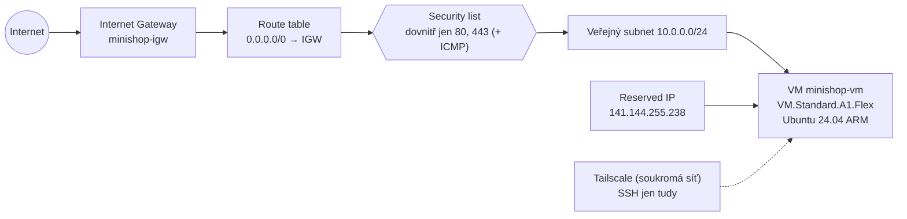

> **V jedné větě:** MiniShop běží v Oracle Cloud Infrastructure (region Frankfurt) na virtuálním stroji **Ampere A1
> (ARM, 2 OCPU, 12 GB RAM)** z bezplatného tarifu *Always Free* – za **0 Kč měsíčně**.

## Proč Oracle Cloud

MiniShop potřebuje **trvale běžící** procesy (RabbitMQ, consumery, outbox worker) a aspoň ~2 GB RAM. Služby, které
se při nečinnosti uspí (serverless), nejsou vhodné.

| Poskytovatel | Co dostanu | Cena / měsíc | Verdikt |
| --- | --- | --- | --- |
| **Oracle Cloud Always Free** | VM ARM 2 OCPU / 12 GB, 200 GB disk, Object Storage 20 GB | **0 Kč** | zvoleno |
| Hetzner, OVH, Netcup (VPS) | 2–4 vCPU / 4 GB | ~120–180 Kč | nad rozpočet, jen „holý server“ |
| Azure Container Apps | nativní cíl Aspire | odhadem 300–600 Kč | nad rozpočet |
| AWS / Google free tier | 1 GB RAM nebo dočasné kredity | 0 Kč jen dočasně | málo paměti |

Výhoda navíc: OCI je **skutečný cloud** – tenancy, compartmenty, IAM politiky, virtuální sítě, objektové úložiště,
rozpočty. Tyto pojmy platí stejně v AWS i Azure.

## Co se v účtu nastavilo a proč

> **Přirovnání:** Tenancy je nájemní smlouva na celou budovu. Compartment je jedna kancelář pro projekt.
> Technický uživatel je řemeslník s klíčem jen od té kanceláře. Rozpočet je hlídač elektroměru.

| Nastavení | Hodnota | Proč |
| --- | --- | --- |
| Domovský region | **Frankfurt** (`eu-frankfurt-1`) | nejblíž ČR, 3 availability domains (víc šancí na volnou A1 kapacitu). Nejde později změnit. |
| Administrátor + **MFA** | váš login | hlavní klíč od všeho – jen na správu, chráněný druhým faktorem |
| **Rozpočet** `minishop-budget` | 4 € měsíčně, upozornění při 1 % skutečné útraty a 100 % předpovědi | plán stojí 0 Kč, takže každá útrata je signál chyby |
| **Compartment** `minishop` | vše MiniShopu na jednom místě | oddělení od ostatního; práva i kvóty jdou omezit na něj |
| Skupina `minishop-admins` + politika | `manage all-resources in compartment minishop` | nástroje nesmí mimo compartment ani omylem |
| Technický uživatel `minishop-automation` | jen API klíč, žádné heslo do konzole | OCI CLI a OpenTofu nikdy nepracují pod administrátorem |
| **Kvóta** `minishop-quota` | v compartmentu jen A1 do 2 OCPU / 12 GB | pojistka – placený tvar VM se v compartmentu vůbec nedá vytvořit |
| **Pay As You Go** | účet převedený z Free Tier | nečinnou free VM by Oracle mohl po 7 dnech zastavit; PAYG má lepší kapacitu. Free limity platí dál. |
| OCI CLI | z Docker image, ne instalace | bez Pythonu na PC; stejný `~/.oci/config` použije OpenTofu |

## Síť a VM

| Prvek | Nastavení | Proč |
| --- | --- | --- |
| VCN `minishop-vcn` | `10.0.0.0/16`, jen veřejný subnet | jen to, co MiniShop opravdu používá (žádný NAT ani privátní subnet) |
| **Security list** (cloudový firewall) | dovnitř TCP **80** a **443** z internetu, ICMP pro MTU; **22 zavřený** | 80 kvůli ověření Let's Encrypt, 443 pro HTTPS. SSH chodí jen přes Tailscale. |
| Firewall na VM (iptables) | povolené 80/443 před závěrečným `REJECT` | obraz Ubuntu od Oracle odmítá vše kromě SSH – druhá vrstva ochrany |
| **Reserved IP** | `141.144.255.238`, `prevent_destroy` | na ni ukazuje DNS; přežije i nové vytvoření VM (jinak nová IP, nový DNS záznam, nový certifikát) |
| Tvar VM | `VM.Standard.A1.Flex` 2 OCPU / 12 GB | maximum Always Free v roce 2026; MiniShop potřebuje ~1 GB |
| Obraz | Ubuntu 24.04 aarch64 (ne Minimal) | Minimal nemá balíčky z přípravy serveru (`netfilter-persistent`…) |
| Oracle Cloud Agent | předinstalovaný | posílá metriky CPU a paměti pro alarmy ([Monitoring](monitoring.md)) |

Kód: [network.tf](code:infra/network.tf), [compute.tf](code:infra/compute.tf). Původně se vše naklikalo ručně
v konzoli (na pochopení), pak se popsalo kódem a ruční zdroje se smazaly – viz [Infrastruktura jako kód](infrastruktura-jako-kod.md).

## Příprava nové VM (cloud-init)

Při prvním startu VM provede [cloud-init.yaml.tftpl](code:infra/cloud-init.yaml.tftpl) a skript
[bootstrap.sh.tftpl](code:infra/bootstrap.sh.tftpl) (log `/var/log/minishop-bootstrap.log`):

1. povolí 80/443 ve firewallu VM,
2. nainstaluje Docker,
3. připojí VM do **Tailscale** (jednorázový auth key),
4. založí uživatele `deploy` s klíčem, který smí spustit **jen** `minishop-deploy` ([CD](../github/cd.md)),
5. zapíše systemd jednotky noční zálohy ([Zálohy](zalohy.md)).

Aplikaci cloud-init nespouští – VM nedostane žádné secrets. Konfiguraci a první start udělá až workflow Deploy z GitHubu.

## Známá omezení a rizika

- VM je **ARM** – image se proto stavějí pro obě architektury.
- Při zakládání A1 VM může přijít *Out of host capacity* – pomůže jiná availability domain nebo počkat.
- Jedna VM = žádná vysoká dostupnost. Pro výukový projekt přijatelné; havárie se řeší obnovou ze zálohy.

## Na internetu

- [Oracle Cloud Always Free](https://www.oracle.com/cloud/free/)
- [OCI: Compartments](https://docs.oracle.com/en-us/iaas/Content/Identity/compartments/managingcompartments.htm)
- [OCI: IAM politiky – začínáme](https://docs.oracle.com/en-us/iaas/Content/Identity/policiesgs/get-started-with-policies.htm)
- [OCI: Security lists](https://docs.oracle.com/en-us/iaas/Content/Network/Concepts/securitylists.htm)
- [OCI: Budgets](https://docs.oracle.com/en-us/iaas/Content/Billing/Concepts/budgetsoverview.htm)
- [cloud-init – dokumentace](https://cloudinit.readthedocs.io/)
