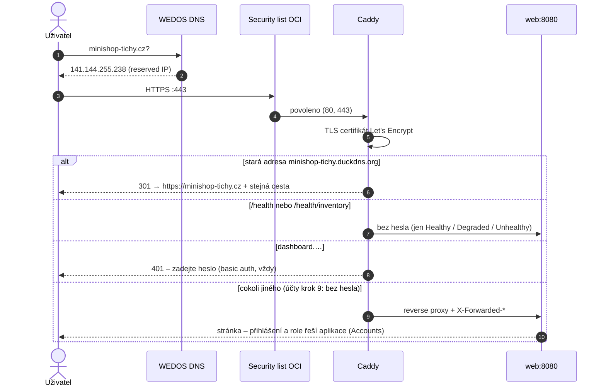

> **V jedné větě:** Na adresu `minishop-tichy.cz` odpovídá **Caddy**, který sám získá certifikát
> **Let's Encrypt** a předá požadavek Webu (dashboard jen s heslem). Původní adresa `minishop-tichy.duckdns.org`
> trvale přesměruje na novou. Správce se na server dostane jen přes **Tailscale**.

## Cesta požadavku

## Části a proč právě ony

| Část | Co dělá | Proč |
| --- | --- | --- |
| **Doména `minishop-tichy.cz`** (Wedos) | vlastní doména druhého řádu; DNS hostuje Wedos zdarma – dva záznamy A (`@` a `dashboard`) na reserved IP, TTL 300, bez AAAA | sdílené domény zdarma (DuckDNS) mají u antivirů a firemních filtrů špatnou pověst – stejnou adresu zneužívají i podvodníci. Vlastní doména `.cz` stojí řádově stovky Kč ročně. |
| **DuckDNS** (dřívější) | původní adresa `minishop-tichy.duckdns.org` – Caddy z ní trvale (301) přesměruje na novou doménu i s cestou | staré záložky a odkazy z e-mailů (potvrzení účtu, reset hesla) dál fungují. Záznam u DuckDNS musí dál ukazovat na reserved IP. |
| **Reserved IP** | pevná veřejná adresa | DNS na ni ukazuje; nová VM ji převezme |
| **Caddy** | reverse proxy: HTTPS, obnova certifikátu, přesměrování http → https, basic auth (dashboard), komprese, skrytí hlaviček `Server` a `Via` | certifikát bez jediného řádku konfigurace navíc (oproti Nginx + certbot) |
| **Let's Encrypt** | bezplatné certifikáty, ověření přes port 80 (HTTP-01) | standard; Caddy se o obnovu stará sám |
| **Basic auth** | jedno heslo (uživatel `minishop`) – od účtů kroku 9 jen před Aspire dashboardem | web má vlastní přihlášení a role ([Accounts](../architektura/moduly/accounts.md)), proto `BASIC_AUTH=off` v `production.env`; `on` web znovu zamkne |
| **Tailscale** | soukromá síť (WireGuard) mezi PC správce, VM a runnerem GitHub Actions | SSH (22) nemusí být otevřené do internetu |

Kód: [Caddyfile](code:deploy/Caddyfile), [compose.cloud.yaml](code:deploy/compose.cloud.yaml).

## Co se nastavilo

- **Caddyfile** – dva weby: `{$DOMAIN}` (aplikace) a `dashboard.{$DOMAIN}` (Aspire dashboard, **vždy** s heslem –
  logy obsahují údaje z objednávek) a přesměrování `{$LEGACY_DOMAIN}` (+ `dashboard.`) → 301 na novou doménu
  (cloud krok 13). Proměnné (`production.env` → `compose.cloud.yaml`) doplní Caddy z prostředí ještě před čtením souboru.
- **Jen HTTP/1.1 a HTTP/2** – HTTP/3 by potřeboval UDP 443 v security listu i ve firewallu VM.
- **Heslo jako bcrypt otisk** (`caddy hash-password`) – samotné heslo nikde neleží; otisk je secret
  `BASIC_AUTH_HASH` v GitHubu ([Secrets](../github/secrets.md)).
- **Volume `caddy-data`** drží certifikáty – bez něj by Caddy po každém restartu žádal o nový a narazil na limity
  Let's Encrypt. **Nemazat.**
- **Změna Caddyfile** se do běžícího Caddy dostane přes `caddy reload` (dělá to `deploy.sh`) – Caddy ji sám nenačte.
- **Tailscale ACL**: na VM (`tag:minishop-vm`) smí port 22 jen členové sítě a runner CI (`tag:ci`).
  Port 22 v security listu je zavřený; nouzově jde dočasně povolit z vlastní IP.

## Známá omezení

- Basic auth je jedno sdílené heslo – žádné role ani odhlášení. Proto chrání jen dashboard; web je od účtů kroku 9
  veřejný a spoléhá na vlastní přihlášení, zámek účtu, rate limiting a bezpečnostní hlavičky (účty krok 8).
- `/health` je veřejné – vrací jen stav (`Healthy`…), žádná data.

## Na internetu

- [Caddy – dokumentace](https://caddyserver.com/docs/)
- [Caddy: Automatic HTTPS](https://caddyserver.com/docs/automatic-https)
- [Let's Encrypt: Jak to funguje](https://letsencrypt.org/how-it-works/)
- [Wedos – znalostní báze (DNS)](https://kb.wedos.com/)
- [DuckDNS](https://www.duckdns.org/)
- [Tailscale: Jak funguje](https://tailscale.com/blog/how-tailscale-works)
