> **V jedné větě:** MiniShop běží v **Docker kontejnerech** na jednom virtuálním stroji v **Oracle Cloud** (zdarma);
> před ním je **Caddy** s HTTPS a heslem a každý commit do `main` se tam sám nasadí přes **GitHub Actions**.

## Big picture nasazení

```mermaid
flowchart LR
    dev(["Vývojář<br/>PC + Aspire"]) -->|"git push, PR"| gh["GitHub<br/>repozitář ftichy/MiniShop"]
    gh --> ci["GitHub Actions<br/>CI: build, testy, image"]
    ci -->|"docker push<br/>amd64 + arm64"| ghcr[("GHCR<br/>registry imagí")]
    ci -->|"Deploy přes Tailscale + SSH"| vm

    subgraph oci["Oracle Cloud – Frankfurt (Always Free)"]
        subgraph vm["VM minishop-vm (ARM, Ubuntu 24.04, Docker Compose)"]
            caddy["Caddy<br/>HTTPS + heslo"]
            web["web"]
            inv["inventory-api"]
            mq["rabbitmq"]
            dash["aspire-dashboard"]
        end
        bucket[("Object Storage<br/>zálohy, state OpenTofu")]
        mon["Monitoring<br/>alarmy VM"]
    end

    vm -->|"docker pull"| ghcr
    user(["Uživatel<br/>prohlížeč"]) -->|"HTTPS minishop-tichy.duckdns.org"| caddy
    duck["DuckDNS<br/>doména"] -.-> caddy
    le["Let's Encrypt<br/>certifikát"] -.-> caddy
    caddy --> web
    web --> inv
    web <--> mq
    inv <--> mq
    vm -->|"noční záloha 02:30"| bucket
    uptime["UptimeRobot<br/>/health zvenku"] -.-> caddy
    hc["healthchecks.io<br/>hlídá zálohu"] -.- vm

    click dev "/Docs/nasazeni/lokalne"
    click gh "/Docs/github/repozitar"
    click ci "/Docs/github/ci"
    click ghcr "/Docs/github/ci"
    click caddy "/Docs/nasazeni/https-a-pristup"
    click web "/Docs/nasazeni/kontejnery"
    click inv "/Docs/nasazeni/kontejnery"
    click mq "/Docs/nasazeni/kontejnery"
    click dash "/Docs/nasazeni/monitoring"
    click bucket "/Docs/nasazeni/zalohy"
    click mon "/Docs/nasazeni/monitoring"
    click uptime "/Docs/nasazeni/monitoring"
    click hc "/Docs/nasazeni/zalohy"
    click duck "/Docs/nasazeni/https-a-pristup"
    click le "/Docs/nasazeni/https-a-pristup"
```

## Cesta commitu do produkce

1. Změna jde do větve a **pull requestu** – `main` je chráněný, přímý push nejde.
2. **CI** v PR sestaví řešení, spustí testy a zkušebně sestaví Docker image ([CI](../github/ci.md)).
3. Po sloučení CI na `main` sestaví image pro **x86 i ARM** a uloží je do **GHCR** se štítkem `sha-<commit>`.
4. **Deploy** se přes Tailscale připojí na VM a spustí `minishop-deploy <sha>` ([CD](../github/cd.md)).
5. Skript na VM stáhne konfiguraci pro daný commit, sestaví `.env`, stáhne image a spustí je. Když kontejnery
   nejsou zdravé, **vrátí předchozí verzi**.
6. Smoke test zvenku ověří HTTPS a `/health` obou služeb.

Celé to trvá několik minut a nikdo se nemusí přihlásit na server.

## Prostředí

| Prostředí | Jak se spouští | K čemu | Stránka |
| --- | --- | --- | --- |
| Vývoj (PC) | `dotnet run --project src/MiniShop.AppHost` (Aspire) | psaní kódu, ladění, dashboard | [Lokální vývoj](lokalne.md) |
| „Produkce na PC“ | `docker compose up` ve složce `deploy` | ověření kontejnerů bez cloudu | [Kontejnery](kontejnery.md) |
| Produkce (cloud) | automaticky z `main` | https://minishop-tichy.duckdns.org | [Oracle Cloud](cloud-oci.md) |

## Proč takhle

- **Rozpočet 0 Kč** (limit byl 100 Kč/měsíc): Oracle Always Free, GitHub zdarma pro veřejný repozitář,
  DuckDNS, Let's Encrypt, UptimeRobot a healthchecks.io ve free tarifech.
- **Jedna VM + Docker Compose** místo Kubernetes – pro dvě malé služby a jednoho uživatele bohatě stačí a dá se
  pochopit celé. Kubernetes by přidal desítky nových pojmů bez užitku.
- **Všechno je v kódu** – Dockerfile, Compose, OpenTofu, workflow. Smazaná VM se obnoví příkazem a zálohou
  (vyzkoušeno cvičnou havárií).

## Na internetu

- [The Twelve-Factor App](https://12factor.net/) – principy, podle kterých je aplikace připravená do kontejnerů
- [Martin Fowler: Continuous Delivery](https://martinfowler.com/bliki/ContinuousDelivery.html)
