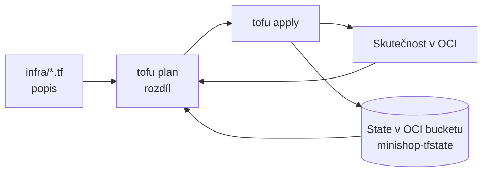

> **V jedné větě:** Místo klikání v konzoli je celá cloudová infrastruktura popsaná v **OpenTofu** ve složce `infra/`;
> příkaz `tofu apply` porovná popis se skutečností a dorovná rozdíly.

> **Přirovnání:** Ruční nastavení je vaření „od oka“. Infrastruktura jako kód je recept – podle něj uvaří stejné
> jídlo kdokoli a kolikrát chce. A když se jídlo spálí (VM zmizí), uvaří se znovu.

## Soubory

| Soubor | Co popisuje |
| --- | --- |
| [versions.tf](code:infra/versions.tf) | verze OpenTofu a providera `oracle/oci`, kde leží state |
| [variables.tf](code:infra/variables.tf) | vstupy (OCID compartmentu, velikost VM, e-mail pro alarmy…) |
| [network.tf](code:infra/network.tf) | VCN, internet gateway, route table, security list, subnet |
| [compute.tf](code:infra/compute.tf) | VM, cloud-init, reserved IP |
| [cloud-init.yaml.tftpl](code:infra/cloud-init.yaml.tftpl), [bootstrap.sh.tftpl](code:infra/bootstrap.sh.tftpl) | příprava nové VM při prvním startu |
| [backup.tf](code:infra/backup.tf) | bucket záloh, lifecycle 7 dní, politika pro VM |
| [monitoring.tf](code:infra/monitoring.tf) | alarmy VM a e-mailová notifikace |
| [outputs.tf](code:infra/outputs.tf) | co vypsat po `apply` (IP, OCID…) |
| [terraform.tfvars.example](code:infra/terraform.tfvars.example), [backend.hcl.example](code:infra/backend.hcl.example) | vzory skutečných vstupů (ty nejsou v gitu) |

## Jak se používá

```text
cd infra
tofu init "-backend-config=backend.hcl"   # jednou (v PowerShellu v uvozovkách)
tofu plan                                 # co by se změnilo
tofu apply                                # provede to
```

Spouští se na PC správce pod technickým uživatelem `minishop-automation` (smí jen do compartmentu `minishop`).



## Důležitá rozhodnutí

| Rozhodnutí | Proč |
| --- | --- |
| **OpenTofu**, ne Terraform | open-source fork Terraformu (licence MPL), stejný jazyk i provider |
| **State v OCI Object Storage** (S3 API) | state není v gitu (obsahuje citlivé údaje), přežije ztrátu PC, je verzovaný |
| VM má `ignore_changes` na obraz a metadata | nový obraz Ubuntu ani změna cloud-init nesmí **sama** smazat a vytvořit VM (ztráta dat) |
| Novou VM jen vědomě: `tofu apply -replace=oci_core_instance.vm` | změna cloud-init nebo `deploy.sh` se na VM dostane jen tak |
| Reserved IP a bucket záloh mají `prevent_destroy` | ani `tofu destroy` je omylem nesmaže |
| Dynamická skupina `minishop-vm` se zakládá ručně | je na úrovni tenancy, kam `minishop-automation` nesmí |
| Bash v šablonách jen `$var`, ne `${var}` | `${…}` je syntaxe OpenTofu – nahradil by ji svou hodnotou |

## Nová VM (např. po havárii)

1. Nový Tailscale auth key do `terraform.tfvars`, `tofu apply -replace=oci_core_instance.vm`.
2. V Tailscale adminu vrátit VM adresu `100.126.167.103`, aktualizovat `DEPLOY_KNOWN_HOSTS` v GitHubu.
3. GitHub → Actions → **Deploy** → *Run workflow* se SHA commitu.
4. Data: `sudo -u deploy /opt/minishop/restore.sh latest` ([Zálohy](zalohy.md)).

Vyzkoušeno cvičnou havárií: VM smazaná → `tofu apply` → Deploy → obnova → objednávky zpět.

## Na internetu

- [OpenTofu – dokumentace](https://opentofu.org/docs/)
- [Provider oracle/oci](https://search.opentofu.org/provider/oracle/oci/latest)
- [HashiCorp: Co je infrastruktura jako kód](https://developer.hashicorp.com/terraform/tutorials/aws-get-started/infrastructure-as-code)
