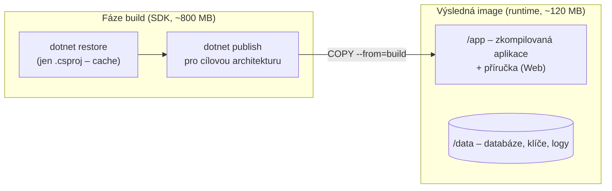
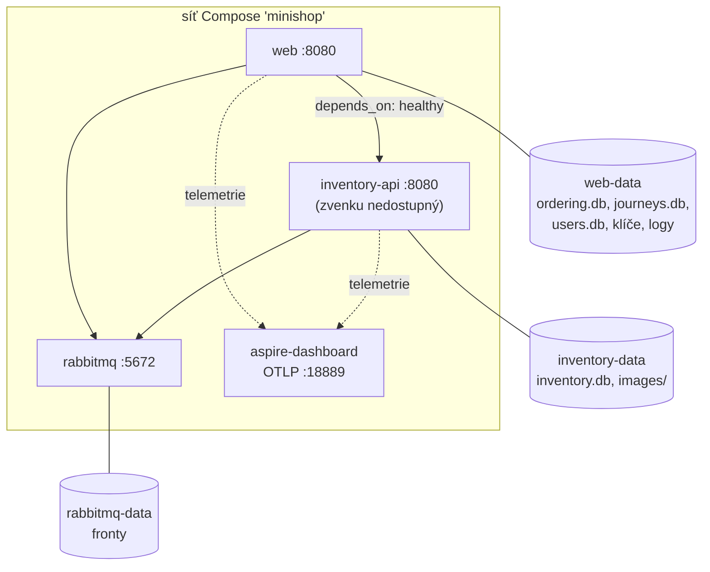

> **V jedné větě:** Každá služba má **Dockerfile**, ze kterého vznikne image s hotovou aplikací; **Docker Compose**
> podle `deploy/compose.yaml` spustí všechny kontejnery, propojí je sítí a dá jim trvalé disky (volumes).

> **Přirovnání:** Image je krabice s nábytkem i návodem – všude se poskládá stejně. Compose je plánek bytu:
> kam co patří a co je s čím propojené.

## Image služeb (Dockerfile)



| Rozhodnutí | Proč |
| --- | --- |
| **Multi-stage build** | V produkční image není SDK ani zdrojáky – menší a bezpečnější. |
| Nejdřív `COPY *.csproj` + `restore` | Docker si vrstvu pamatuje; při změně kódu se balíčky nestahují znovu. |
| `--platform=$BUILDPLATFORM` + `-a $TARGETARCH` | Kompiluje se nativně, výstup pro ARM i x86 – VM v cloudu je ARM. |
| Uživatel `app` (ne root) | Kdyby někdo aplikaci napadl, nemá v kontejneru práva roota. |
| Data v `/data` | Na tuhle složku se připojí volume – data přežijí nový image. |
| Konfigurace přes `ENV` | Cesty k DB, klíčům a logům jde přepsat proměnnou prostředí ([12-factor](https://12factor.net/config)). |

Kód: [Dockerfile Webu](code:src/MiniShop.Web/Dockerfile), [Dockerfile skladu](code:src/MiniShop.Inventory.Api/Dockerfile),
[.dockerignore](code:.dockerignore) (do image se nesmí dostat lokální databáze, logy ani tajnosti).

Sestavení ručně (z kořene repozitáře): `docker build -f src/MiniShop.Web/Dockerfile -t minishop-web .`

## Docker Compose



Co dřív dělal Aspire AppHost, dělá teď [compose.yaml](code:deploy/compose.yaml):

| Aspire (AppHost) | Compose |
| --- | --- |
| `AddRabbitMQ(...)` | služba `rabbitmq` (image `rabbitmq:4-management`) |
| `AddProject<...>("inventory-api")` | služba `inventory-api` – jméno je zároveň DNS adresa v síti |
| `WithReference(messaging)` | proměnná `ConnectionStrings__messaging` |
| `WithReference(inventoryApi)` | proměnná `Services__inventory-api__http__0` |
| `WaitFor(...)` | `depends_on` + `condition: service_healthy` |
| dashboard | služba `aspire-dashboard` (image `mcr.microsoft.com/dotnet/aspire-dashboard`) |

Důležité detaily:

- **Healthcheck .NET služeb** – image nemá `curl`, proto bash otevře TCP spojení přes `/dev/tcp` a pošle ručně
  `GET /health`. Compose pak ví, kdy je služba opravdu připravená.
- **Volumes** přežijí `docker compose down` i nový image. Smaže je jen `docker compose down -v`.
- **Sklad není publikovaný ven** – dostane se k němu jen Web uvnitř sítě Compose.
- **Pevný `hostname: rabbitmq`** – RabbitMQ ukládá data do složky podle jména stroje; bez něj by po novém
  kontejneru „nenašel“ své fronty.

## Lokálně vs. v cloudu

```text
cd deploy && cp .env.example .env && docker compose up -d --build     # PC → http://localhost:8080
```

Na VM se navíc načte doplněk [compose.cloud.yaml](code:deploy/compose.cloud.yaml) (řádek
`COMPOSE_FILE=compose.yaml:compose.cloud.yaml` v [production.env](code:deploy/production.env)):

- přidá **Caddy** (HTTPS, heslo) – viz [Doména, HTTPS a přístup](https-a-pristup.md),
- Webu a dashboardu **odebere publikované porty** (`ports: !reset []`) – ven jde jen přes Caddy,
- image se berou z **GHCR** (`IMAGE_PREFIX=ghcr.io/ftichy/`, `IMAGE_TAG=sha-…`), lokálně se staví z `build:`.

## Data Protection klíče

ASP.NET podepisuje antiforgery token formulářů klíči. V kontejneru by se po každém restartu (= každém nasazení)
vytvořily nové a otevřený formulář objednávky by skončil chybou 400. Proto je Web ukládá do `/data/keys` na volume.

## Na internetu

- [Docker: Multi-stage builds](https://docs.docker.com/build/building/multi-stage/)
- [Docker Compose – přehled](https://docs.docker.com/compose/)
- [Microsoft: .NET v kontejnerech](https://learn.microsoft.com/dotnet/core/docker/introduction)
- [ASP.NET Core Data Protection](https://learn.microsoft.com/aspnet/core/security/data-protection/introduction)
