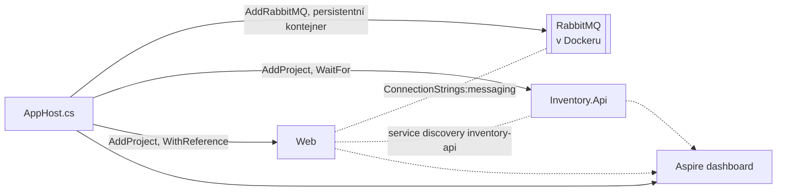

> **V jedné větě:** Při vývoji vše spouští **.NET Aspire AppHost** – nastartuje RabbitMQ v Dockeru, obě služby,
> předá jim adresy a otevře dashboard s trasami, logy a metrikami.

## Spuštění

```text
dotnet run --project src/MiniShop.AppHost
```

| Co | Kde |
| --- | --- |
| Web (objednávky, UI, tato dokumentace) | https://localhost:7180 |
| Inventory.Api (sklad) | https://localhost:7181 |
| Aspire dashboard | https://localhost:17180 (přihlašovací odkaz vypíše konzole) |
| RabbitMQ management | odkaz v dashboardu (zdroj `messaging`) |

Potřeba: .NET SDK podle `global.json` a **Docker** (Docker Desktop) kvůli RabbitMQ.

## Co AppHost dělá



- [AppHost.cs](code:src/MiniShop.AppHost/AppHost.cs) popisuje aplikaci jako kód: kdo existuje a kdo potřebuje koho.
- Heslo k RabbitMQ vygeneruje Aspire a uloží do *user secrets* AppHostu; služby ho dostanou v connection stringu.
- Kontejner RabbitMQ je **persistentní** – po zastavení AppHostu běží dál (fronty přežijí restart). Pozor: zastavení
  AppHostu nechá běžet kontejner `messaging-…`.
- Sdílené nastavení služeb (health checky, service discovery, resilience HTTP, OpenTelemetry) je v
  [ServiceDefaults](code:src/MiniShop.ServiceDefaults/ServiceDefaultsExtensions.cs).

## Bez Aspire

```text
docker start minishop-rabbit        # poprvé: docker run -d --name minishop-rabbit -p 5672:5672 -p 15672:15672 rabbitmq:4-management
dotnet run --project src/MiniShop.Inventory.Api
dotnet run --project src/MiniShop.Web
```

Adresu skladu najde Web v `Services:inventory-api` v `appsettings.Development.json`.

## Databáze

SQLite soubory vznikají samy (`EnsureCreated`) vedle projektu: `ordering.db`, `journeys.db`, `users.db` (Web) a
`inventory.db` (sklad, s ukázkovými produkty). **Při změně schématu** je potřeba soubory smazat – projekt nepoužívá migrace.

## Testy

```text
dotnet build MiniShop.slnx
dotnet test MiniShop.slnx
```

Testy nepotřebují Docker ani RabbitMQ: obě databáze jsou SQLite v paměti a zprávy jdou přes `InProcessIntegrationBus`.

## Proč Aspire

- Jeden příkaz místo několika terminálů a ručního předávání adres.
- **Dashboard** s trasami přes obě služby a RabbitMQ – bez něj se EDA ladí velmi těžko.
- Stejný dashboard běží i v cloudu (jako samostatný kontejner), takže se nemusíte učit dva nástroje.

V cloudu AppHost **neběží** – jeho práci převezme Docker Compose ([Kontejnery](kontejnery.md)).

## Na internetu

- [.NET Aspire – přehled](https://learn.microsoft.com/dotnet/aspire/get-started/aspire-overview)
- [Aspire: service defaults](https://learn.microsoft.com/dotnet/aspire/fundamentals/service-defaults)
