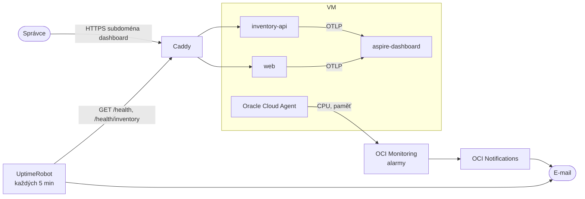

> **V jedné větě:** Zevnitř aplikace sledujeme trasy, logy a metriky v **Aspire dashboardu**; zvenku hlídá
> **UptimeRobot** adresu `/health` a zevnitř cloudu **alarmy OCI** stav VM. Při problému přijde e-mail.

## Kdo co hlídá

| Hlídač | Co sleduje | Kdy se ozve |
| --- | --- | --- |
| **Aspire dashboard** | trasy, strukturované logy, metriky obou služeb | nic neposílá – díváte se do něj (https://dashboard.minishop-tichy.duckdns.org) |
| **Health checky** `/health` | připravenost služby + [outbox](../eda/outbox.md) (zpráva visí > 5 min → *Degraded*) | využívá je Compose (`up --wait`), Deploy i UptimeRobot |
| **UptimeRobot** | zvenku `/health` a `/health/inventory`, hledá přesný text `Healthy` | služba neodpovídá nebo není *Healthy* |
| **Alarmy OCI** ([monitoring.tf](code:infra/monitoring.tf)) | CPU > 80 %, paměť > 90 %, metriky přestaly chodit | podmínka platí 15 min v kuse; připomenutí každé 4 h |
| **healthchecks.io** | jestli proběhla noční záloha | viz [Zálohy](zalohy.md) |

## Proč takhle

- **Aspire dashboard, ne Grafana/Loki/Prometheus** – stejný nástroj jako lokálně, jeden kontejner, nulová konfigurace.
  Plnohodnotný stack by na malé VM zabral víc paměti než MiniShop sám.
- **Telemetrie jen v paměti** (limit 512 MB) – stačí na „co se stalo před chvílí“. Historii drží logy v souborech
  (`/data/logs`, 7 dní).
- **Přihlášení k dashboardu přes Caddy** – dashboard sám běží `Unsecured`, port OTLP je jen ve vnitřní síti Compose.
- **UptimeRobot aktivně zvenku** – pozná i výpadek sítě, DNS nebo certifikátu, což zevnitř VM nejde.
- **Alarmy v OpenTofu** – po nové VM se nastaví samy (nové OCID).
- **15 minut** trvání podmínky – build nebo restart krátce vytíží CPU a alarm by zbytečně budil.

## Logy

- Serilog píše do konzole kontejneru (`docker compose logs web`), do souboru `/data/logs/minishop-RRRRMMDD.log`
  (7 dní) a přes **OpenTelemetry** do dashboardu, propojené s trasou.
- Úrovně a cíle se nastavují v sekci `Serilog` v `appsettings.json`.

## Na internetu

- [.NET Aspire dashboard (samostatně)](https://learn.microsoft.com/dotnet/aspire/fundamentals/dashboard/standalone)
- [UptimeRobot](https://uptimerobot.com/)
- [OCI Monitoring – alarmy](https://docs.oracle.com/en-us/iaas/Content/Monitoring/Concepts/monitoringoverview.htm)
- [Serilog](https://serilog.net/)
