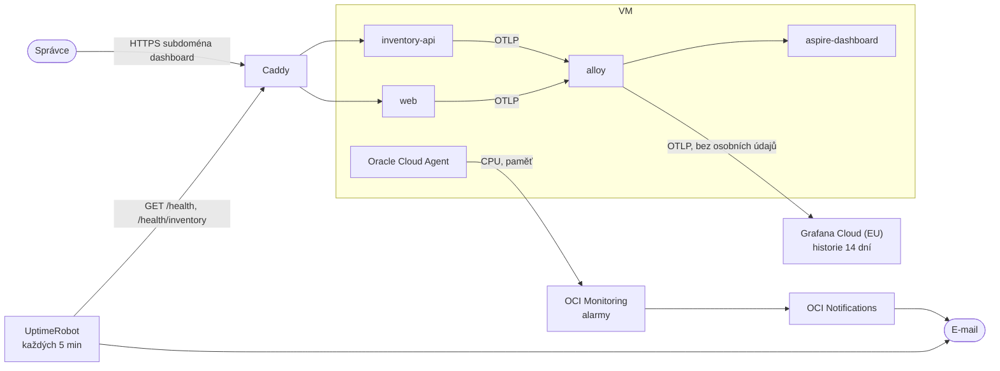

> **V jedné větě:** Zevnitř aplikace sledujeme trasy, logy a metriky živě v **Aspire dashboardu** a s historií 14 dní
> v **Grafana Cloud** (přes **Alloy** na VM); zvenku hlídá
> **UptimeRobot** adresu `/health` a zevnitř cloudu **alarmy OCI** stav VM. Při problému přijde e-mail.

## Kdo co hlídá

| Hlídač | Co sleduje | Kdy se ozve |
| --- | --- | --- |
| **Aspire dashboard** | trasy, strukturované logy, metriky obou služeb – živě, jen v paměti | nic neposílá – díváte se do něj (https://dashboard.minishop-tichy.cz) |
| **Grafana Cloud** (observabilita G1–G3) | totéž s historií 14 dní: trasy (Tempo), logy (Loki), metriky (Mimir); dashboard „Zprávy a ságy“ | e-mailem při alarmu: dead-letter, poison, zaseklý outbox/fronta/sága, 5xx, pomalé potvrzování, SLO, výpadek telemetrie (https://patientjaguar2071.grafana.net) |
| **Health checky** `/health` | připravenost služby + [outbox](../eda/outbox.md) (zpráva visí > 5 min → *Degraded*) + od EDA kroku 13 [dead-letter fronty](../eda/provoz-zprav.md) (odložená zpráva → *Degraded*) | využívá je Compose (`up --wait`), Deploy i UptimeRobot |
| **UptimeRobot** | zvenku `/health` a `/health/inventory`, hledá přesný text `Healthy` | služba neodpovídá nebo není *Healthy* |
| **Alarmy OCI** ([monitoring.tf](code:infra/monitoring.tf)) | CPU > 80 %, paměť > 90 %, metriky přestaly chodit | podmínka platí 15 min v kuse; připomenutí každé 4 h |
| **healthchecks.io** | jestli proběhla noční záloha | viz [Zálohy](zalohy.md) |

## Proč takhle

- **Aspire dashboard pro „teď“** – stejný nástroj jako lokálně, jeden kontejner, nulová konfigurace. Telemetrie jen
  v paměti (limit 512 MB) – stačí na „co se stalo před chvílí“.
- **Grafana Cloud pro historii, ne vlastní Grafana/Loki/Prometheus na VM** – plnohodnotný stack by na malé VM zabral
  víc paměti než MiniShop sám a potřeboval by zálohy a aktualizace. Free tier stačí (0 Kč, bez karty), data v EU.

## Grafana Cloud a Alloy (observabilita G1)

Přirovnání: Aspire dashboard je tachometr (jen „teď“), Grafana Cloud černá skříňka (14 dní zpětně).

- **Alloy** ([config.alloy](code:deploy/config.alloy), [compose.grafana.yaml](code:deploy/compose.grafana.yaml)) přijímá
  OTLP od `web` a `inventory-api` (port 4317 jen v síti Compose) a posílá ho **dvakrát**: celé do Aspire dashboardu
  a do Grafana Cloud. Aplikace se kvůli tomu nezměnila – jen `OTEL_EXPORTER_OTLP_ENDPOINT` ukazuje na Alloy místo dashboardu.
- **Osobní údaje:** před odesláním do cloudu Alloy smaže atributy `client.address`, `client.port`, `network.peer.address`,
  `http.client_ip`, `user_agent.original` a `url.query`. Je to druhá vrstva – aplikace e-maily ani IP do logů a tras
  nepíše ([Účty – zpevnění](../architektura/moduly/accounts.md)). `enduser.id` (ID účtu) zůstává.
- **Přihlášení:** Instance ID a adresa v `deploy/production.env` (netajné), token jen se zápisem v secretu
  `GRAFANA_CLOUD_OTLP_TOKEN` ([Secrets](../github/secrets.md)) – čtení dat z Grafany jím nejde.
- **Výpadek Grafana Cloud** aplikaci neovlivní: Alloy data chvíli drží v paměti a opakuje, pak je zahodí. Výpadek Alloye
  znamená jen díru v telemetrii (Aspire i Grafana), e-shop běží dál.
- **Změna `config.alloy`:** `deploy.sh` po nasazení Alloy restartuje (konfiguraci sám znovu nenačte).
- **Vypnutí:** odebrat `compose.grafana.yaml` z `COMPOSE_FILE` v `deploy/production.env` – služby pak posílají přímo do dashboardu.
- **Lokálně** se nic nemění: AppHost i `compose.yaml` posílají rovnou do Aspire dashboardu. Generálka s Grafanou:
  token do `deploy/.env` a `docker compose -f compose.yaml -f compose.grafana.yaml up -d`.
- **Limity free tieru:** 10 000 aktivních metrických řad (každá kombinace jména metriky a štítků; po nasazení se každá
  kopie služby počítá zvlášť), 50 GB logů a 50 GB tras měsíčně, 14 dní. Využití: Grafana → *Administration → Cost management / Usage*.

**Dashboard „MiniShop – zprávy a ságy“** (observabilita G2): zdroj pravdy je
[minishop-zpravy-a-sagy.json](code:deploy/grafana/minishop-zpravy-a-sagy.json) v gitu, do Grafany se **importuje ručně**
(bez dalšího tokenu): *Dashboards → New → Import → Upload dashboard JSON file* → u „Prometheus (metriky)“ vybrat zdroj
končící `-prom` → *Import*. Změna = upravit JSON v PR a importovat znovu (stejné `uid` → přepíše se).

| Řádek | Co ukazuje |
| --- | --- |
| Je vše v pořádku? | velká čísla: poison, dead-letter, čekající v outboxu a frontách, p95 potvrzení objednávky, chyby 5xx – zelená = v pořádku |
| Zprávy | doručené a zpracované za minutu, chyby, zpoždění outboxu, co kde čeká |
| Ságy a objednávky | rozpracované ságy podle stavu, doba potvrzení (podle platby), potvrzené objednávky za hodinu |
| HTTP | požadavky, doba odpovědi p95, chyby 5xx podle stránky (Web i sklad) |

Metriky stavu popisuje [Observabilita – metriky stavu](../eda/observabilita.md). Řádek **SLO** (od G3) ukazuje podíl
objednávek potvrzených do 30 s za 7 dní, zbývající rozpočet chyb a počet pomalých objednávek.

**Alarmy (observabilita G3)** – pravidla v [minishop-alarmy.yaml](code:deploy/grafana/minishop-alarmy.yaml) (formát Prometheus,
v CI je kontroluje `promtool`), import ručně: *Alerting → Alert rules → Import to Grafana-managed rules → Import from file*,
zdroj `-prom`, složka **MiniShop** (jen pro tyto alarmy – import pravidla ve složce přepíše). E-mail chodí na kontakt
`minishop-email` (*Alerting → Contact points*; v Grafana Cloud vznikl přejmenováním výchozího kontaktu `empty` bez integrace + integrace Email s adresou správce – výchozí politika na něj směruje vše), připomínka po 4 h, při vyřešení zpráva *Resolved*.

| Alarm | Kdy | Co dělat |
| --- | --- | --- |
| `MiniShopDeadLetter` | zpráva v dead-letter frontě 5 min | `/Admin/Messages` → u fronty chyba (`x-minishop-error`) → opravit příčinu → *Vrátit do fronty* ([provoz zpráv](../eda/provoz-zprav.md)) |
| `MiniShopOutboxPoison` | poison zpráva v outboxu 5 min | `/Admin/Messages` → chyba u zprávy → opravit → *Zkusit znovu* |
| `MiniShopOutboxStuck` | zprávy v outboxu čekají 10 min | `/health` (outbox, dead-letters), vedoucí kopie `docker compose logs web \| grep Vedoucí`, RabbitMQ běží? |
| `MiniShopQueueBacklog` | ve frontě čeká > 50 zpráv 10 min | běží služba, která frontu poslouchá? (`docker compose ps`), její logy |
| `MiniShopSagaStuck` | sága čeká na sklad 10 min (timeout je 30 s) | `/health/inventory`, fronta `minishop.inventory`, trasa objednávky v Grafaně (`minishop.order.id`) |
| `MiniShopSlowConfirmation` | p95 potvrzení (bez karty) > 30 s 15 min | dashboard řádek Zprávy (zpoždění outboxu, fronty), trasa pomalé objednávky |
| `MiniShopConfirmationSlo` | za 7 dní < 99 % objednávek do 30 s | jako u pomalého potvrzování; rozpočet chyb je vyčerpaný |
| `MiniShopHttp5xx` | > 3 odpovědi 5xx za 10 min | dashboard Chyby 5xx podle stránky, Explore → `-logs` (úroveň Error) → odkaz na trasu |
| `MiniShopTelemetryMissing` | 10 min nepřišly metriky stavu | `/health`, UptimeRobot, na VM `docker compose ps` (web, alloy), `docker compose logs alloy` |

Prahy jsou pro malý provoz MiniShopu – úprava v YAML (PR) a nový import.

**Kde co najít v Grafaně** (https://patientjaguar2071.grafana.net) – podrobně a krok za krokem na skutečných situacích
([zákazník hlásí problém s objednávkou](grafana-tutorial.md), alarm, pomalý web, po nasazení) v [Grafana krok za krokem](grafana-tutorial.md):

| Chci vidět | Kde |
| --- | --- |
| trasu objednávky | *Explore* → zdroj `…-traces` → *Search*, služba `web` (nebo hledat podle `minishop.order.id`) |
| logy | *Explore* → zdroj `…-logs` → filtr `service_name = web`; z řádku logu odkaz na trasu |
| metriky | *Explore* → zdroj `…-prom` → např. `minishop_outbox_delivered_total` |
- **Přihlášení k dashboardu přes Caddy** – dashboard sám běží `Unsecured`, port OTLP je jen ve vnitřní síti Compose.
- **UptimeRobot aktivně zvenku** – pozná i výpadek sítě, DNS nebo certifikátu, což zevnitř VM nejde.
- **Alarmy v OpenTofu** – po nové VM se nastaví samy (nové OCID).
- **15 minut** trvání podmínky – build nebo restart krátce vytíží CPU a alarm by zbytečně budil.

## Logy

- Serilog píše do konzole kontejneru (`docker compose logs web` – obě kopie Webu, řádky mají předponu `web-<číslo>` – po každém nasazení jiné),
  do souboru `/data/logs/minishop-<kontejner>-RRRRMMDD.log` (škálování krok 5: každá kopie vlastní soubor, 7 dní)
  a přes **OpenTelemetry** do dashboardu a Grafana Cloud (14 dní, hledání bez SSH), propojené s trasou.
- Která kopie je vedoucí (spouští outbox a další workery): `docker compose logs web | grep Vedoucí` –
  viz [Více instancí](../architektura/vice-instanci.md).
- Úrovně a cíle se nastavují v sekci `Serilog` v `appsettings.json`.

## Na internetu

- [.NET Aspire dashboard (samostatně)](https://learn.microsoft.com/dotnet/aspire/fundamentals/dashboard/standalone)
- [Grafana Cloud – OpenTelemetry (OTLP)](https://grafana.com/docs/grafana-cloud/send-data/otlp/)
- [Grafana Alloy](https://grafana.com/docs/alloy/latest/)
- [UptimeRobot](https://uptimerobot.com/)
- [OCI Monitoring – alarmy](https://docs.oracle.com/en-us/iaas/Content/Monitoring/Concepts/monitoringoverview.htm)
- [Serilog](https://serilog.net/)
