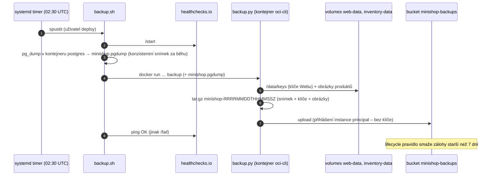
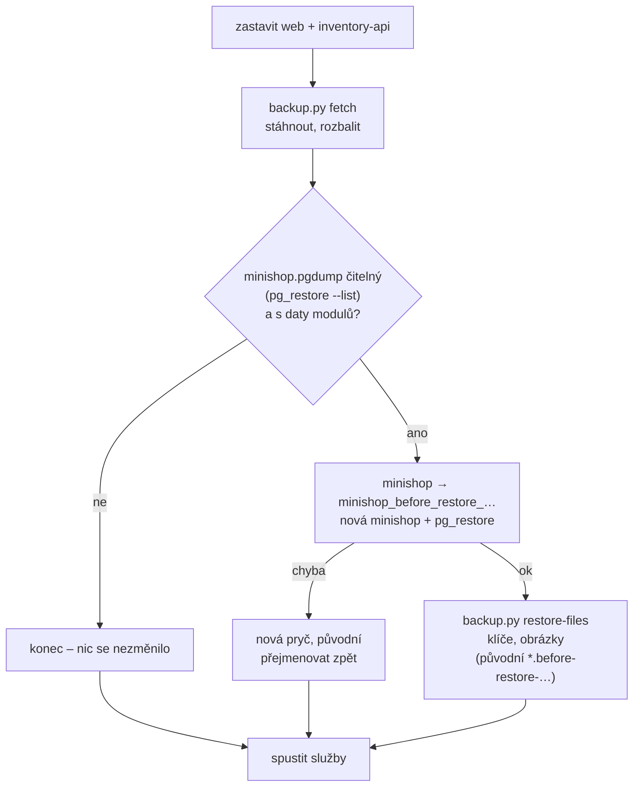

> **V jedné větě:** Každou noc ve 02:30 UTC se udělá konzistentní snímek databáze, klíčů a obrázků, zabalí se a uloží
> do bucketu **mimo VM**; obnova je jeden příkaz `restore.sh latest`.

## Jak záloha funguje



| Část | Kód |
| --- | --- |
| Časovač a služba systemd | [minishop-backup.timer](code:deploy/minishop-backup.timer), [minishop-backup.service](code:deploy/minishop-backup.service) |
| Spouštěč + hlášení na healthchecks.io | [backup.sh](code:deploy/backup.sh) |
| Vlastní záloha a obnova (Python) | [backup.py](code:deploy/backup.py) |
| Obnova | [restore.sh](code:deploy/restore.sh) |
| Bucket, lifecycle, oprávnění | [backup.tf](code:infra/backup.tf) |

## Rozhodnutí a proč

| Rozhodnutí | Proč |
| --- | --- |
| **`pg_dump`, ne kopie souborů databáze** | soubory databáze se mění za běhu – kopie by byla nekonzistentní; `pg_dump` udělá snímek k jednomu okamžiku. Do škálování kroku 3C se zálohovaly SQLite soubory (online backup API) |
| **`--format=custom`** (škálování krok 3A) | konzistentní snímek celé databáze za běhu, obnova přes `pg_restore`; dělá se v kontejneru databáze přes lokální socket – bez hesla ([Databáze](../architektura/databaze.md)) |
| **Instance principal** (identita VM) | na VM neleží žádný klíč ani heslo k úložišti |
| VM smí zapisovat a číst, **ne mazat ani přepsat** | napadená VM zálohy nezničí; staré maže lifecycle pravidlo služby Object Storage |
| **Bucket mimo VM**, `prevent_destroy` | záloha musí přežít smazání VM i omyl v OpenTofu |
| Zálohuje se i `/data/keys` | bez Data Protection klíčů by po obnově neplatily otevřené formuláře |
| Zálohují se i obrázky produktů (`/data/images` skladu, e-shop krok 2B) | jména souborů jsou ve schématu `inventory` – bez souborů by výloha ukazovala chybějící obrázky. Složky se zálohují jako celek (`DIRECTORIES` v `backup.py`); starší záloha bez nich obnovu nezastaví |
| RabbitMQ se nezálohuje | zprávy jsou dočasné; pravda je v outboxech obnovených databází |
| **healthchecks.io** (dead man's switch) | ozve se, když záloha **neproběhne** – to zevnitř VM nikdo nepozná |
| Image `oci-cli` připnutý na verzi | záloha se nesmí rozbít tím, že se změní nástroj |

## Obnova

```text
sudo -u deploy /opt/minishop/restore.sh list                       # co je v bucketu
sudo -u deploy /opt/minishop/restore.sh latest                     # nejnovější záloha
sudo -u deploy /opt/minishop/restore.sh /cesta/minishop-….tar.gz   # záloha z lokálního souboru (bucket nedostupný)
```

Skript ([restore.sh](code:deploy/restore.sh)) **nejdřív všechno zkontroluje, teprve pak mění** (škálování krok 4):



- **PostgreSQL se nemaže, jen přejmenuje** – dosavadní databáze zůstane jako `minishop_before_restore_<čas>`.
  Skript na konci vypíše příkaz `DROP DATABASE …`, kterým ji po ověření webu smažete.
- **Záloha z doby před přepnutím na PostgreSQL** (do 4. 11. 2026 20:52 UTC) má prázdný snímek – skript ji
  odmítne (obnova by smazala všechna data). Když selže založení nebo nahrání databáze, vrátí původní.
- Služby se spustí vždy, i po chybě – s původními daty.
- Ověřeno nanečisto v Compose: úspěšná obnova, odmítnutá stará záloha, poškozený snímek, selhání uprostřed (vrácení).

Po startu služby doplní obnovené databázi chybějící **migrace** schémat
([Sdílené jádro – migrace databází](../architektura/sdilene-jadro.md)). Obnovit jde tedy i starší zálohu;
opačně ne – kód starší než schéma zálohy novější sloupce jen ignoruje. Zálohy z doby SQLite (do 4. 11. 2026) obnovit nejde – lifecycle je stejně do 7 dní smaže.

Před rizikovou akcí ruční záloha: `sudo systemctl start minishop-backup`.

**Nový modul (nové schéma) zálohuje `pg_dump` automaticky – celou databázi `minishop`. Nová složka s daty
(jako obrázky) = přidat do `DIRECTORIES` v `backup.py`.**

## Cvičná havárie

Obnova, kterou nikdo nezkusil, je jen přání. Proto proběhla zkouška: VM se smazala → `tofu apply` vytvořila novou →
workflow Deploy nasadil aplikaci → `restore.sh latest` vrátil data → objednávky byly zpět.

## Na internetu

- [PostgreSQL: pg_dump](https://www.postgresql.org/docs/current/app-pgdump.html), [pg_restore](https://www.postgresql.org/docs/current/app-pgrestore.html)
- [OCI: Object Storage lifecycle](https://docs.oracle.com/en-us/iaas/Content/Object/Tasks/usinglifecyclepolicies.htm)
- [OCI: Instance principals](https://docs.oracle.com/en-us/iaas/Content/Identity/Tasks/callingservicesfrominstances.htm)
- [healthchecks.io](https://healthchecks.io/)
