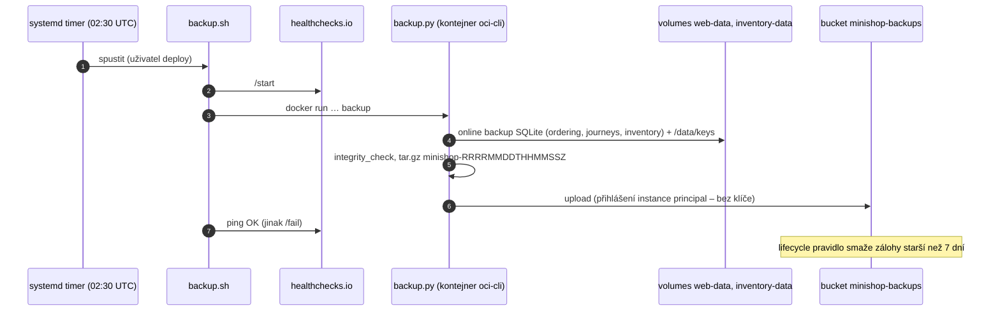

> **V jedné větě:** Každou noc ve 02:30 UTC se udělá konzistentní snímek všech databází a klíčů, zabalí se a uloží
> do bucketu **mimo VM**; obnova je jeden příkaz `restore.sh latest`.

## Jak záloha funguje



| Část | Kód |
| --- | --- |
| Časovač a služba systemd | [minishop-backup.timer](code:deploy/minishop-backup.timer), [minishop-backup.service](code:deploy/minishop-backup.service) |
| Spouštěč + hlášení na healthchecks.io | [backup.sh](code:deploy/backup.sh) |
| Vlastní záloha a obnova (Python) | [backup.py](code:deploy/backup.py) |
| Obnova | [restore.sh](code:deploy/restore.sh) |
| Bucket, lifecycle, oprávnění | [backup.tf](code:infra/backup.tf) |

## Rozhodnutí a proč

| Rozhodnutí | Proč |
| --- | --- |
| **Online backup API SQLite**, ne kopie souboru | soubor může být uprostřed zápisu – kopie by byla poškozená; `.backup` udělá konzistentní snímek za běhu |
| **Instance principal** (identita VM) | na VM neleží žádný klíč ani heslo k úložišti |
| VM smí zapisovat a číst, **ne mazat ani přepsat** | napadená VM zálohy nezničí; staré maže lifecycle pravidlo služby Object Storage |
| **Bucket mimo VM**, `prevent_destroy` | záloha musí přežít smazání VM i omyl v OpenTofu |
| Zálohuje se i `/data/keys` | bez Data Protection klíčů by po obnově neplatily otevřené formuláře |
| RabbitMQ se nezálohuje | zprávy jsou dočasné; pravda je v outboxech obnovených databází |
| **healthchecks.io** (dead man's switch) | ozve se, když záloha **neproběhne** – to zevnitř VM nikdo nepozná |
| Image `oci-cli` připnutý na verzi | záloha se nesmí rozbít tím, že se změní nástroj |

## Obnova

```text
sudo -u deploy /opt/minishop/restore.sh list     # co je v bucketu
sudo -u deploy /opt/minishop/restore.sh latest   # nejnovější záloha
```

Skript zastaví `web` a `inventory-api` (nikdo nezapisuje), stáhne zálohu, zkontroluje ji (`integrity_check`),
vymění soubory ve volumes (původní nechá jako `*.before-restore-…`) a služby znovu spustí.

Před rizikovou akcí ruční záloha: `sudo systemctl start minishop-backup`.

**Nová databáze nebo soubor s daty = přidat do `DATABASES` v `backup.py`.**

## Cvičná havárie

Obnova, kterou nikdo nezkusil, je jen přání. Proto proběhla zkouška: VM se smazala → `tofu apply` vytvořila novou →
workflow Deploy nasadil aplikaci → `restore.sh latest` vrátil data → objednávky byly zpět.

## Na internetu

- [SQLite: Online Backup API](https://www.sqlite.org/backup.html)
- [OCI: Object Storage lifecycle](https://docs.oracle.com/en-us/iaas/Content/Object/Tasks/usinglifecyclepolicies.htm)
- [OCI: Instance principals](https://docs.oracle.com/en-us/iaas/Content/Identity/Tasks/callingservicesfrominstances.htm)
- [healthchecks.io](https://healthchecks.io/)
