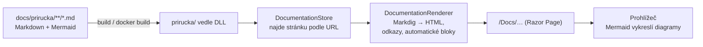

> **V jedné větě:** Dokumentace je sada Markdown souborů v `docs/prirucka`, které Web při zobrazení převede
> na HTML. Je součástí buildu i Docker image, takže **nasazená aplikace má vždy dokumentaci ke stejnému commitu**.

## Jak to funguje



- Kód: [Documentation/](code:src/MiniShop.Web/Documentation/), stránka [Pages/Docs](code:src/MiniShop.Web/Pages/Docs/).
- Při vývoji (`Development`) čte Web soubory **přímo z repozitáře** (`Documentation:ContentPath`) – změnu textu
  uvidíte po obnovení stránky, bez buildu.
- Knihovny: [Markdig](https://github.com/xoofx/markdig) (Markdown → HTML na serveru) a
  [Mermaid](https://mermaid.js.org/) (diagramy v prohlížeči, lokální kopie ve `wwwroot/lib/mermaid`).

## Jak napsat stránku

Soubor `docs/prirucka/<sekce>/<nazev>.md`; adresa stránky je cesta bez `.md` (malá písmena, číslice, pomlčky).
Stránka složky je `index.md`. Na začátku hlavička:

```text
---
title: Název stránky
summary: Jedna věta – zobrazí se pod nadpisem a v rozcestníku „Jdi hlouběji“.
order: 3
---
```

Doporučená kostra stránky konceptu: **V jedné větě** → **Jaký problém řeší / Přirovnání** → **Jak to funguje
v MiniShopu** (diagram) → **Proč takhle** → **Kód** → **Na internetu**.

| Chci | Napíšu |
| --- | --- |
| odkaz na jinou stránku | `[Inbox](../eda/inbox.md)` – relativně k souboru, jako na GitHubu |
| odkaz do kódu na GitHubu | `[OrderService](code:src/MiniShop.Application/Ordering/OrderService.cs)` |
| odkaz na složku v kódu | `[EventHandlers](code:src/MiniShop.Application/Ordering/EventHandlers/)` (lomítko na konci) |
| klikací uzel diagramu | v bloku `mermaid`: `click uzel "/Docs/eda/saga"` |
| obsah vygenerovaný z kódu | samostatný řádek `{{auto:contracts}}` |

Dostupné automatické bloky: `contracts` (integrační zprávy), `domain-events` (doménové události),
`journey-event-types` (typy událostí Journeys), `nuget-packages` (NuGet balíčky s verzemi z `*.deps.json` běžící aplikace).

Odkazy do kódu vedou na produkci na **commit, ze kterého běží image** (proměnná `Documentation__Commit`
= `IMAGE_TAG`), jinak na větev `main`.

## Co hlídá aktuálnost

Text se sám nepřepíše, ale testy v
[DocumentationTests](code:tests/MiniShop.Tests/Web/DocumentationTests.cs) nepustí změnu, která dokumentaci rozbije:

- každá stránka má název a shrnutí a jde vykreslit,
- odkazy mezi stránkami (i kliky v diagramech) vedou na existující stránky,
- odkazy do kódu vedou na existující soubory – **přejmenujete-li třídu, test vám řekne, kterou stránku opravit**,
- každý projekt ve `src/` je v dokumentaci zmíněný,
- každý kontrakt a každá doménová událost je zmíněná i mimo automatickou tabulku (tj. někdo popsal, k čemu je),
- každý NuGet balíček (ze všech `.csproj`), každá Docker image z Compose a Dockerfile a každá GitHub Action
  z workflow je v katalogu [třetích stran](treti-strany/index.md),
- každý secret a proměnná z `deploy.yml` je popsaná v [Secrets](github/secrets.md),
- každý soubor ve `deploy/` a `infra/` je v dokumentaci zmíněný.

## Kdy se dokumentace nasadí

Příručka je součást image Webu. Push do `main`, který mění jen `docs/prirucka/**`, proto **spustí CI i nasazení**
(ostatní čistě dokumentační změny nic nestaví) – viz [CI](github/ci.md).

Pravidlo pro vývoj: **změna chování = úprava příslušné stránky ve stejném PR.**
