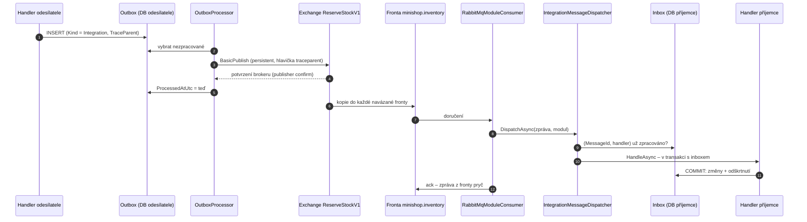

> **Shrnutí:** Zpráva má dvě „pojistky“: **outbox** u odesílatele (neztratí se) a **inbox** u příjemce
> (nezpracuje se dvakrát). Mezi nimi ji drží RabbitMQ.

## Šťastná cesta

## Co když se něco pokazí

| Kde | Co se stane | Výsledek |
| --- | --- | --- |
| Broker neběží při publish | výjimka `IntegrationBusUnavailableException`, zpráva zůstane v outboxu, **nepočítá se jako pokus** | odejde, až broker naběhne |
| Pád odesílatele po publish, před označením | zpráva odejde znovu | inbox příjemce duplicitu přeskočí |
| Handler příjemce vyhodí výjimku | transakce se vrátí, *nack + requeue* po 2 s | zkouší se znovu (bez limitu) |
| Pád příjemce před ack | RabbitMQ zprávu doručí znovu (`redelivered`) | inbox duplicitu přeskočí |
| Nečitelná zpráva (neznámý typ, vadný JSON) | *nack bez requeue* | zahozena, v logu varování |
| Doménový handler selže 5× | outbox přestane zkoušet (*poison message*) | čeká na člověka, `/health` po 5 min *Degraded* |

## Kód

[OutboxProcessor](code:src/MiniShop.Infrastructure/Outbox/OutboxProcessor.cs) ·
[RabbitMqIntegrationBus](code:src/MiniShop.Infrastructure/Integration/RabbitMq/RabbitMqIntegrationBus.cs) ·
[RabbitMqQueueConsumer](code:src/MiniShop.Infrastructure/Integration/RabbitMq/RabbitMqQueueConsumer.cs) ·
[IntegrationMessageDispatcher](code:src/MiniShop.Infrastructure/Integration/IntegrationMessageDispatcher.cs) ·
[InboxGuard](code:src/MiniShop.Infrastructure/Inbox/InboxGuard.cs) ·
[testy outboxu](code:tests/MiniShop.Tests/Infrastructure/OutboxTests.cs)

## Související

[Outbox](../eda/outbox.md) · [Inbox](../eda/inbox.md) · [Broker](../eda/broker.md) · [Observabilita](../eda/observabilita.md)
