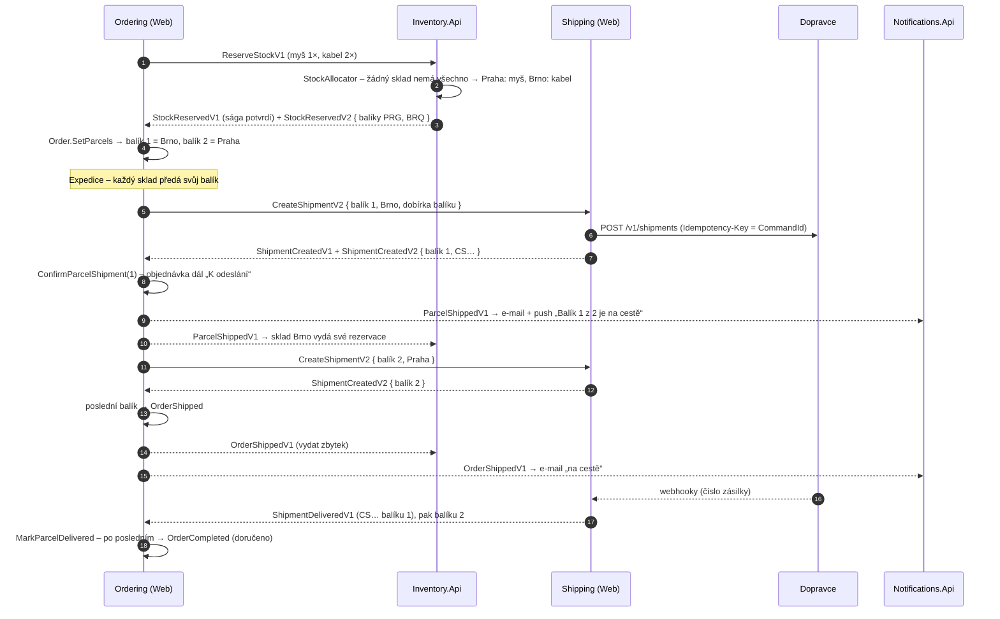
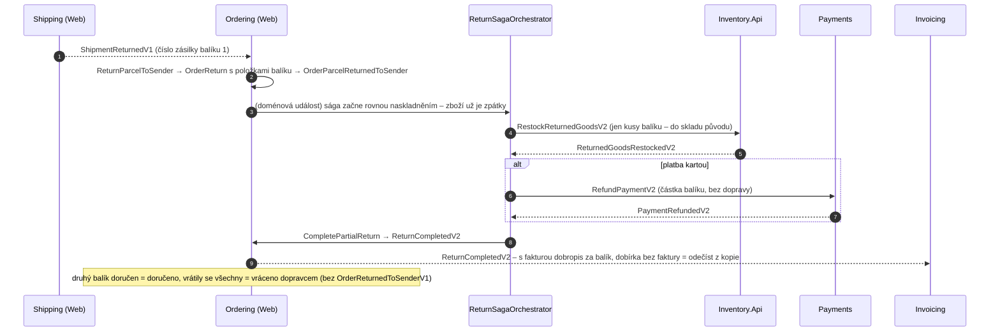

> **Shrnutí:** Odkud se zboží vezme, rozhoduje **sklad** (přidělení zásob – jeden sklad, když to jde). Když to nejde, pošle
> Orderingu rozdělení jako **balíky** (`StockReservedV2`). Každý balík předá jeho sklad dopravci zvlášť (`CreateShipmentV2`),
> objednávka je odeslaná s posledním balíkem a doručená, až skončí všechny (scatter-gather v agregátu `Order`).
> Balík, který dopravce vrátí, se kompenzuje sám – **automatickou vratkou po částech**. Plán směru:
> [Sklady-roadmap](code:docs/Sklady-roadmap.md); moduly [Inventory](../architektura/moduly/inventory.md),
> [Ordering](../architektura/moduly/ordering.md), [Shipping](../architektura/moduly/shipping.md).

## Rozdělení a odeslání po balících

## Vrácený balík = vratka po částech

## Na co si dát pozor

- **Sága objednávky se nemění** – na balíky nečeká, potvrzení dál řídí `StockReservedV1`.
- **Doručení a vrácení bez nových verzí** – zprávy nesou číslo zásilky a podle něj Ordering najde balík.
- **Kompenzace jen jednou:** každý vrácený balík má svou vratku; kdyby se po vrácení všech balíků poslalo ještě
  `OrderReturnedToSenderV1`, peníze i zboží by se vracely podruhé.
