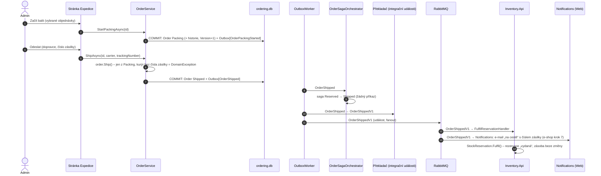

> **Shrnutí:** Admin na stránce **Expedice** (`/Admin/Fulfilment`) objednávku zabalí, odešle (kurýr: dopravce
> a číslo zásilky) a nakonec označí jako doručenou. Odeslání je **fakt**, který zajímá víc stran: sklad podle
> integrační události `OrderShippedV1` změní rezervaci na **výdej**, zákazník dostane e-mail s číslem zásilky.
> Sága jen zaznamená, že zboží už nevrací.

## Odeslání

## Doručení

„Doručeno“ zatím kliká admin (simulace dopravce – skutečný by poslal webhook, e-shop krok 8):
`CompleteAsync` → `order.MarkDelivered()` (jen ze `Shipped`) → `OrderCompleted` → sága `Shipped → Completed`,
integrační `OrderCompletedV1` (podle ní e-mail „doručeno“ z modulu Notifications) (kontrakt zůstal stejný, jen teď znamená „doručeno“).

## Proč událost, a ne příkaz

Rezervaci řídí sága **příkazem** (`ReserveStockV1`) a čeká na odpověď – rezervace může selhat (málo zboží) a sága
podle výsledku rozhoduje. Výdej odeslaného zboží selhat nemůže: zboží už je fyzicky pryč. Stačí proto oznámit
fakt a každý, koho zajímá, si ho zpracuje sám (**choreografie**). Sklad i modul Notifications (e-shop krok 7) –
Ordering kvůli novému odběrateli nic měnit nemusí.

## Souběh: odeslat × zrušit

Zákazník může zrušit i během balení. Když ve stejné chvíli admin odesílá, oba načtou objednávku se stejnou
`Version`. První uložení projde a verzi zvýší, druhé narazí na `UPDATE … WHERE Version = původní` → žádný řádek
→ `ConcurrencyConflictException`. Nic se nepřepíše: buď je objednávka zrušená (zboží se vrátí), nebo odeslaná
(rezervace vydaná) – nikdy obojí. Adminovi stránka ukáže „Objednávka se mezitím změnila“.

## Co si všimnout

- **Po odeslání zrušit nejde** – pravidlo hlídá `Order.Cancel`, tlačítko na stránce je jen pohodlí.
- **Vydanou rezervaci nejde uvolnit** – kdyby přece jen přišel `ReleaseStockV1`, sklad ji přeskočí
  (hledá jen aktivní rezervace).
- **Osobní odběr** má stejné stavy s jinými popisky („Připravujeme“, „K vyzvednutí“, „Vyzvednutá“) a bez dopravce.

## Kód

[Order](code:src/MiniShop.Domain/Orders/Order.cs) ·
[OrderService](code:src/MiniShop.Application/Ordering/OrderService.cs) ·
[Expedice (stránka)](code:src/MiniShop.Web/Pages/Admin/Fulfilment/Index.cshtml.cs) ·
[FulfilReservationHandler](code:src/MiniShop.Application/Inventory/FulfilReservationHandler.cs) ·
[StockReservation](code:src/MiniShop.Domain/Inventory/StockReservation.cs) ·
[OrderShippedV1](code:src/MiniShop.Contracts/Orders/OrderShippedV1.cs)
