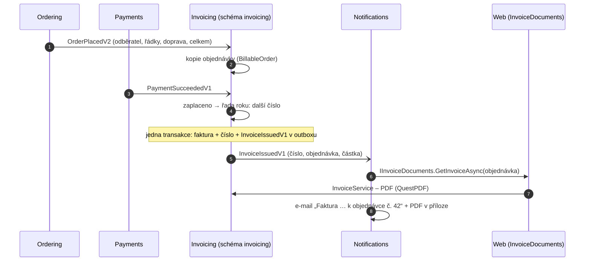
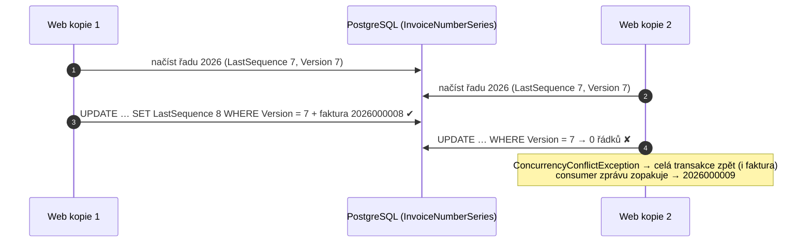

> **Shrnutí:** Faktura vzniká **z událostí, které už existují** – Ordering ani Payments se kvůli ní nezměnily.
> Modul Invoicing si z `OrderPlacedV2` uloží, komu a co fakturovat, a jakmile přijde „zaplaceno“
> (`PaymentSucceededV1`, u dobírky `OrderCompletedV1`), vystaví fakturu a oznámí `InvoiceIssuedV1`.
> Notifications pak pošle e-mail s PDF v příloze.

Přirovnání: účetní ve vedlejší kanceláři sleduje nástěnku. Když tam visí „objednávka 42: Jan, myš, 200 Kč“
a „objednávka 42 zaplacena“, vezme další číslo z knihy faktur, vystaví fakturu a pošle ji poštou.

## Platba kartou

- **Dobírka a objednávky z API:** místo `PaymentSucceededV1` rozhodne `OrderCompletedV1` (zaplaceno při převzetí).
- **Zprávy mimo pořadí:** když platba předběhne vznik, kopie se založí jen s „zaplaceno“ a faktura vznikne,
  až dorazí `OrderPlacedV2`. Když `InvoiceIssuedV1` předběhne `OrderPlacedV2` v Notifications, e-mail se zkusí znovu.
- **PDF nejde přes RabbitMQ** – ve zprávě je jen číslo. Notifications si PDF vezmou přes rozhraní `IInvoiceDocuments`,
  které implementuje Web (oba moduly běží ve stejném procesu), stejně jako `ICustomerContacts` u připomínky košíku.

## Číselná řada a souběh

Proč ne sekvence databáze: ta číslo při rollbacku nevrátí a v řadě by zůstala díra. Zákon chce řadu nepřerušenou.

## Co vidí zákazník a admin

- **Detail objednávky** `/Orders/{id}`: „Faktura č. … – stáhnout PDF“ (`/Orders/{id}/Invoice`, cizí = 404).
- **E-mail** s PDF v příloze (šablona `OrderEmailTemplates.Invoice`).
- **Admin** `/Admin/Invoices`: nejnovější faktury s odkazem na PDF a objednávku.

Kód: [InvoicingHandler](code:src/MiniShop.Application/Invoicing/InvoicingHandler.cs),
[InvoiceEmailHandler](code:src/MiniShop.Application/Notifications/InvoiceEmailHandler.cs),
[QuestPdfInvoiceRenderer](code:src/MiniShop.Infrastructure/Invoicing/QuestPdfInvoiceRenderer.cs). Modul: [Invoicing](../architektura/moduly/invoicing.md).
