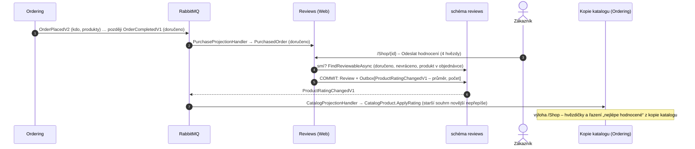
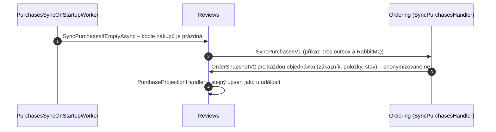

> **Shrnutí:** Hodnotit smí jen ten, kdo produkt **koupil a dostal**. Modul Reviews se kvůli tomu neptá Orderingu –
> drží si **vlastní kopii nákupů** z událostí, které už existují (`OrderPlacedV2`, `OrderCompletedV1`,
> `ReturnCompletedV1`). Po každém hodnocení oznámí souhrn `ProductRatingChangedV1` a Ordering si ho uloží do kopie
> katalogu – výloha pak ukáže hvězdičky i řazení „nejlépe hodnocené“ bez jediného dotazu navíc.

Přirovnání: recenzi píše jen ten, kdo má účtenku – a prodejna si kopie účtenek drží sama, nechodí se ptát do účtárny.

## Odeslání hodnocení

## Nákupy z doby před modulem

Modul Reviews vznikl, když už objednávky existovaly. Po startu s prázdnou kopií nákupů si o ně řekne – stejný vzor
jako obnova katalogu nebo přestavění přehledu tržeb:

**Proč `OrderSnapshotV2`, a ne `OrderSnapshotV1`?** V1 (přehled tržeb) záměrně nenese zákazníka – přehled osobní
údaje nepotřebuje. Reviews ano (kdo co koupil). Nová verze kontraktu místo změny staré: odběratelé V1 se nemění.

## Na co si dát pozor

- **Zprávy mimo pořadí:** doručení může dorazit dřív než vznik. `PurchasedOrder` se založí hned a vznik ho doplní;
  doručení i vrácení se jen zapínají – výsledek nezávisí na pořadí.
- **Souhrn ve stejné transakci** jako hodnocení (outbox) – průměr ve výloze nikdy „neuteče“ od hodnocení.
- **Osobní údaje:** autor jen „Jan N.“; po smazání účtu „Smazaný zákazník“ a kopie nákupů pryč (`CustomerAnonymizedV1`).
- Stránka produktu spojuje dva moduly (katalog z Orderingu, hodnocení z Reviews) – spojuje je až Web, moduly se neznají.

## Kód

[ReviewService](code:src/MiniShop.Application/Reviews/ReviewService.cs) ·
[PurchaseProjectionHandler](code:src/MiniShop.Application/Reviews/PurchaseProjectionHandler.cs) ·
[SyncPurchasesHandler](code:src/MiniShop.Application/Ordering/IntegrationEvents/SyncPurchasesHandler.cs) ·
[CatalogProjectionHandler](code:src/MiniShop.Application/Ordering/Catalog/CatalogProjectionHandler.cs) ·
[ProductRatingChangedV1](code:src/MiniShop.Contracts/Reviews/ProductRatingChangedV1.cs) ·
[SyncPurchasesV1](code:src/MiniShop.Contracts/Reviews/SyncPurchasesV1.cs) ·
[OrderSnapshotV2](code:src/MiniShop.Contracts/Orders/OrderSnapshotV2.cs)
