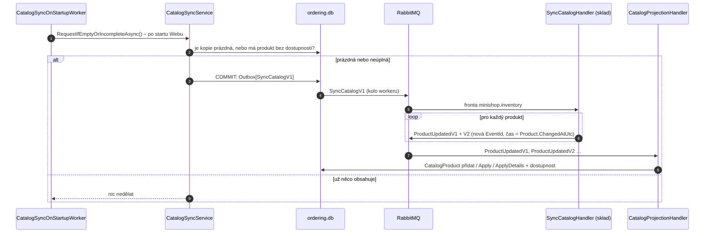

> **Shrnutí:** Události o produktech chodí jen při změně. Nová `ordering.db` by tak zůstala bez katalogu.
> Proto Web po startu (nebo tlačítkem) pošle příkaz `SyncCatalogV1` a sklad odpoví `ProductUpdatedV1` a `ProductUpdatedV2`
> pro každý produkt. E-shop krok 2: obnova proběhne i u **neúplné** kopie – produkty z doby před výlohou nemají
> dostupnost a kategorii (migrace jim dala `Unknown`), po nasazení je tak Web doplní sám.

## Co si všimnout

- **Čas zprávy = čas poslední změny produktu**, ne „teď“. Kdyby byl „teď“, mohl by znovu poslaný starý stav
  přebít novější změnu, která je zrovna na cestě.
- **Nové `EventId`** – jinak by inbox Orderingu zprávu považoval za už zpracovanou.
- Žádost jde **přes outbox** – když sklad nebo broker zrovna neběží, počká a odejde později.
- Ručně: tlačítko na stránce *Objednávky*.

## Známé omezení

Obnova produkty nemaže – produkt, jehož `ProductRemovedV1` se ztratil, v kopii zůstane.

## Kód

[CatalogSyncOnStartupWorker](code:src/MiniShop.Web/BackgroundServices/CatalogSyncOnStartupWorker.cs) ·
[CatalogSyncService](code:src/MiniShop.Application/Ordering/Catalog/CatalogSyncService.cs) ·
[SyncCatalogHandler](code:src/MiniShop.Application/Inventory/SyncCatalogHandler.cs)
