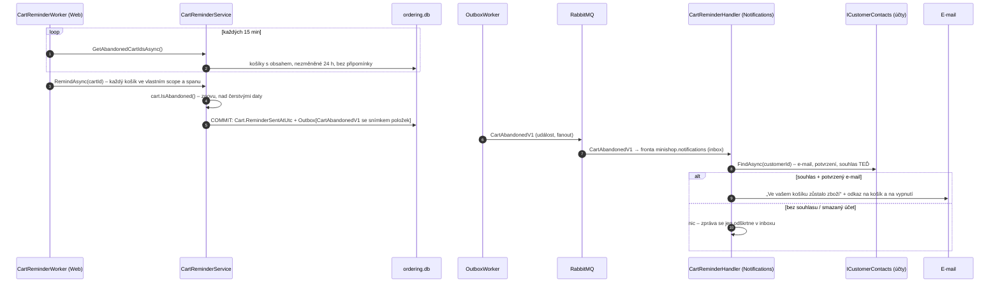

> **Shrnutí:** Většinou reagujeme na událost, která **přišla**. Opuštěný košík je reakce na to, že **nepřišla**:
> zákazník si dal zboží do košíku a 24 hodin se nic nestalo (žádná změna, žádná objednávka). Takovou „událost
> z ticha“ musí někdo **hledat** – `CartReminderWorker` (jako timeout ságy). Ordering pak oznámí fakt
> `CartAbandonedV1` a modul Notifications rozhodne, jestli smí psát: jen s **platným souhlasem** zákazníka.

Přirovnání: prodavač si u pokladny všimne vozíku, u kterého už hodinu nikdo nestojí. Nezavolá zákazníkovi hned –
jen zapíše „opuštěný vozík“. Jestli mu smí poslat SMS, zjistí podle kartičky věrnostního programu, kterou vytáhne
**až v tu chvíli** (zákazník mohl souhlas mezitím odvolat).

## Tok

## Pravidla

- **Opuštěný** = košík není prázdný, `Carts:AbandonedAfterHours` (24) se nezměnil a připomínka ještě nešla
  (`Cart.IsAbandoned`). Změna obsahu počítá „ticho“ znovu.
- **Nejvýš jedna připomínka na nákup:** `ReminderSentAtUtc` se vynuluje, až se košík vyprázdní (objednávka,
  vyprázdnění, odebrání posledního řádku). Přidat zboží po připomínce = pořád stejný nákup.
- **Značka a zpráva v jedné transakci** (outbox): připomínka se neztratí ani neodejde dvakrát. Souběh se
  zákazníkem (změnil košík mezi vyhledáním a uložením) zachytí concurrency token `CheckoutId` – košík se přeskočí.
- **Připomínka nemění verzi pro pokladnu** – otevřená pokladna v jiné záložce dál platí.
- **Souhlas výchozí vypnutý**, zapíná se na stránce *Nastavení e-mailů* (`/Account/EmailPreferences`). Píšeme jen
  na potvrzený e-mail.

## Proč souhlas až při odeslání

U objednávek si Notifications příjemce **kopíruje** ze zprávy (`OrderPlacedV2`, *event-carried state transfer*) –
e-mail o objednávce patří k nákupu a posílá se vždy. Připomínka je marketing: souhlas musí platit **v okamžiku
odeslání**. Mezi vznikem zprávy a doručením (outbox, fronta, výpadek) ho zákazník mohl vypnout nebo smazat účet.
Proto `CartAbandonedV1` nenese e-mail ani souhlas, jen ID účtu, a `CartReminderHandler` se zeptá přes
`ICustomerContacts`. Implementaci (`IdentityCustomerContacts`) dodává Web, který hostuje účty i Notifications –
moduly se dál neznají.

## Proč bez doménové události

Ordering na opuštění košíku sám nijak nereaguje, takže `CartReminderService` pošle integrační událost rovnou
přes `IOrderingMessagePublisher` (jako `CustomerAnonymizedV1`). Doménová událost by byla jen mezikrok bez posluchače.

## Kód

[Cart](code:src/MiniShop.Domain/Orders/Carts/Cart.cs) ·
[CartReminderService](code:src/MiniShop.Application/Ordering/Carts/CartReminderService.cs) ·
[CartReminderWorker](code:src/MiniShop.Web/BackgroundServices/CartReminderWorker.cs) ·
[CartAbandonedV1](code:src/MiniShop.Contracts/Carts/CartAbandonedV1.cs) ·
[CartReminderHandler](code:src/MiniShop.Application/Notifications/CartReminderHandler.cs) ·
[CartEmailTemplates](code:src/MiniShop.Application/Notifications/CartEmailTemplates.cs) ·
[IdentityCustomerContacts](code:src/MiniShop.Web/Accounts/IdentityCustomerContacts.cs)
