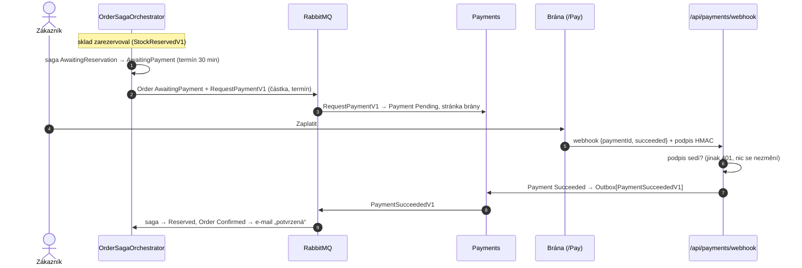
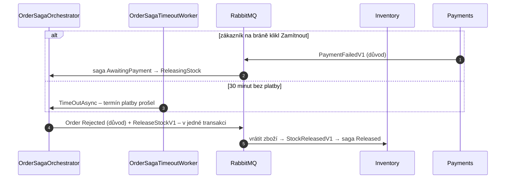

> **Shrnutí:** U platby kartou sága po rezervaci zboží objednávku nepotvrdí hned. Pošle příkaz `RequestPaymentV1`
> modulu Payments a čeká – nejvýš `Sagas:PaymentTimeoutMinutes` (30 min). Zákazník zaplatí na stránce brány, brána
> pošle **podepsaný webhook**, Payments oznámí `PaymentSucceededV1` a sága objednávku potvrdí. Dobírka platbu přeskočí.

## Zaplaceno

## Nezaplaceno – zamítnutí nebo vypršení

## Pozdní platba = vrácení peněz

Zákazník zaplatí ve 30. minutě a 1. vteřině – sága už objednávku zamítla a zboží vrátila. Brána ale peníze
vzala a `PaymentSucceededV1` dorazí. Sága ve stavu `Rejected` / `ReleasingStock` / `Released` pošle
**`RefundPaymentV1`** (kompenzace, jen jednou – `RefundRequested`), Payments vrátí peníze a oznámí
`PaymentRefundedV1`, zákazník dostane e-mail „platbu vracíme“. Stejný vzor jako pozdní rezervace po timeoutu
skladu ([Timeout a kompenzace](timeout-a-kompenzace.md)). Simulovaná brána po termínu zaplatit nepustí, skutečná
by mohla.

## Co si všimnout

- **Webhook bez přihlášení, ale s podpisem.** Brána účet nemá; kdo nezná tajemství, podpis nespočítá
  (401). Opakovaný webhook vrátí 200 a nic nezdvojí – brány posílají znovu, dokud nedostanou 2xx.
- **Zamítnutí, ne zrušení.** Nezaplacená objednávka je `Rejected` („systém ji nemohl vyřídit“) – `Cancelled`
  znamená „zrušil člověk“. Zrušit jde i objednávku, která na platbu čeká (e-shop krok 9) – stránka brány pak
  platit nedovolí a zaplacenou objednávku sága při zrušení vrátí (`RefundPaymentV1`), viz [Zrušení](zruseni-a-vyrizeni.md).
- **Zboží drží rezervace** po celou dobu čekání na platbu – proto termín.
- Zákazník po pokladně skončí na detailu objednávky s tlačítkem **Zaplatit**; detail se obnovuje, dokud se
  na platbu čeká.

## Kód

[OrderSaga](code:src/MiniShop.Domain/Orders/Saga/OrderSaga.cs) ·
[OrderSagaOrchestrator](code:src/MiniShop.Application/Ordering/Saga/OrderSagaOrchestrator.cs) ·
[Payment](code:src/MiniShop.Domain/Payments/Payment.cs) ·
[PaymentWebhookProcessor](code:src/MiniShop.Application/Payments/PaymentWebhookProcessor.cs) ·
[Pay/Index](code:src/MiniShop.Web/Pages/Pay/Index.cshtml.cs)
