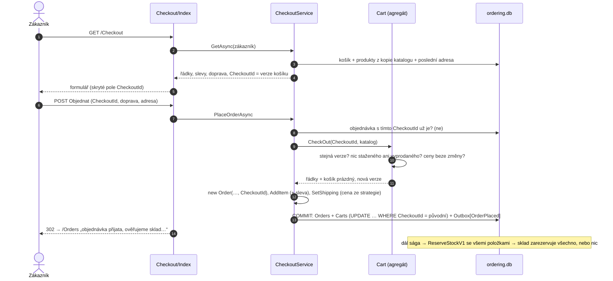
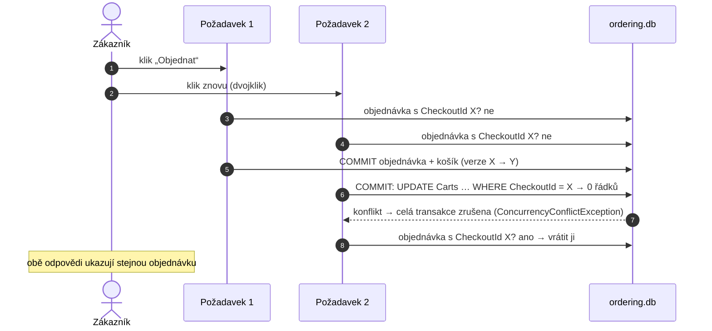

> **Shrnutí:** Pokladna je jediné místo, kde se nezávazný košík mění v závazek. Formulář nese **verzi košíku**
> (`CheckoutId`). Podle ní server pozná, že zákazník objednává přesně to, co viděl, a že stejné odeslání už
> objednávku založilo. Objednávka a vyprázdněný košík se uloží **v jedné transakci**. Dál jde všechno stejně jako
> v [Vytvoření objednávky](vytvoreni-objednavky.md): sága, sklad, potvrzení. Přirovnání: u pokladny v obchodě
> se zboží namarkuje, zaplatí a vozík se vyprázdní – nikdy jen půlka z toho.

## Běžné objednání

## Dvojí odeslání a souběh

- **Postupně (F5 po odeslání):** druhý požadavek najde objednávku podle `CheckoutId` hned na začátku – nic nezakládá.
- **Současně:** verze košíku je *concurrency token* (EF hlídá `WHERE CheckoutId = původní`) a `Orders.CheckoutId`
  má unikátní index. Kterákoli z těch dvou pojistek zruší druhou transakci. Infrastruktura ji převede na
  `ConcurrencyConflictException` (aplikační vrstva o EF Core neví) a pokladna vrátí objednávku prvního požadavku.
- **REST API** to umí taky: `POST /api/orders` s volitelným `checkoutId` (klient si ho vygeneruje a při opakování
  pošle stejné).

## Změna ceny a starý formulář

| Situace | Co se stane |
| --- | --- |
| Admin změní cenu produktu v košíku | Pokladna ukáže „Ceny se změnily“ a tlačítko **Přijmout nové ceny**; dokud je zákazník nepotvrdí, `Cart.CheckOut` objednávku nepustí. Žádné tiché zdražení ani zlevnění. |
| Zákazník mezitím změní košík v jiné záložce | Každá změna košíku = nová verze. Starý formulář pokladny neprojde („Košík se mezitím změnil“), stránka se ukáže znovu s aktuálním obsahem. |
| Produkt se vyprodá nebo zmizí z nabídky | Pokladna ho označí a objednat nejde, dokud ho zákazník neodebere. |
| Sklad mezitím nemá dost kusů | Pokladna to nepozná (zásobu zná jen sklad). Objednávka vznikne a sága ji zamítne s důvodem, který produkt chybí – viz [Zamítnutí objednávky](zamitnuti-objednavky.md). |

Kód: [CheckoutService.cs](code:src/MiniShop.Application/Ordering/Checkout/CheckoutService.cs),
`Cart.CheckOut` v [Cart.cs](code:src/MiniShop.Domain/Orders/Carts/Cart.cs),
[Checkout/Index.cshtml.cs](code:src/MiniShop.Web/Pages/Checkout/Index.cshtml.cs),
převod výjimek v [ModuleDbContext.cs](code:src/MiniShop.Infrastructure/Persistence/ModuleDbContext.cs).
