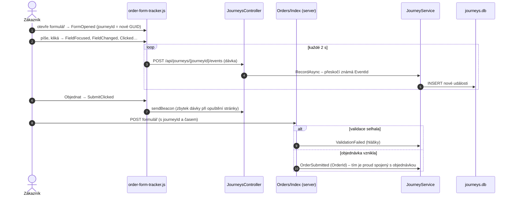
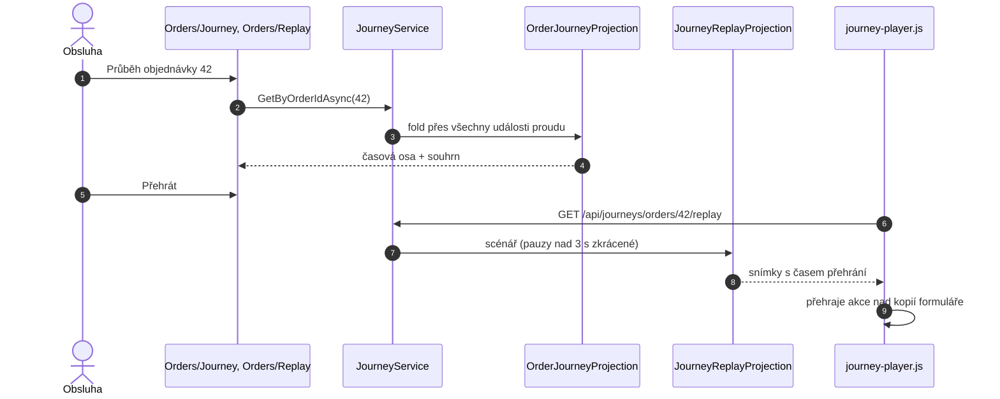

> **Shrnutí:** Skript v prohlížeči sbírá akce ve formuláři a každé 2 s je pošle dávkou na server. Server
> doplní své události (chyba validace, vznik objednávky). Stránky *Průběh* a *Přehrát* pak proud promítnou.

## Záznam

## Zobrazení a přehrání

## Co si všimnout

- **Sledování nesmí rozbít objednávku** – chyba zápisu do `journeys.db` se jen zaloguje.
- Čas událostí je relativní k otevření formuláře – dávky můžou dorazit v libovolném pořadí.
- Prvky, které má přehrávač najít, mají atribut `data-track`; `Replay.cshtml` má ruční kopii formuláře
  (nové pole formuláře je potřeba přidat i tam).

## Kód

[order-form-tracker.js](code:src/MiniShop.Web/wwwroot/js/order-form-tracker.js) ·
[JourneysController](code:src/MiniShop.Web/Controllers/JourneysController.cs) ·
[JourneyService](code:src/MiniShop.Application/Journeys/JourneyService.cs) ·
[journey-player.js](code:src/MiniShop.Web/wwwroot/js/journey-player.js)
