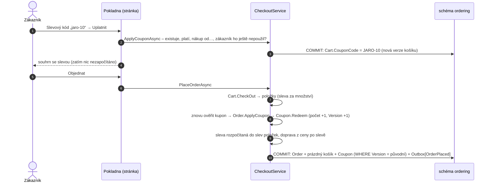
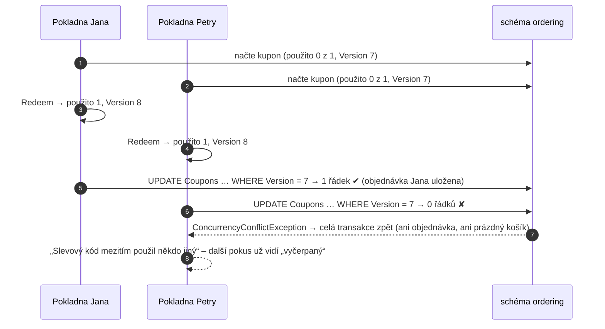

> **Shrnutí:** Zákazník v pokladně uplatní slevový kód (procenta nebo Kč, s platností, minimem nákupu a limitem
> použití). Použití se započítá až **při objednání – ve stejné transakci** jako objednávka a vyprázdnění košíku
> (kupon i objednávka jsou v modulu Ordering). O poslední použití při souběhu rozhodne **verze kuponu**
> (concurrency token). Zamítnutá nebo zrušená objednávka použití vrátí (**kompenzace** přes doménové události).

Přirovnání: poslední kus zboží v regálu. Sáhnou po něm dva lidé naráz, ale do košíku ho dá jen jeden – druhý
dostane omluvu, ne zboží „navíc“.

## Uplatnění a objednání

## Souběh o poslední použití

Stejný vzor jako `Order.Version` (odeslat × zrušit) nebo `Cart.CheckoutId` (dvojklik v pokladně) – žádný zámek,
jen kontrola verze při zápisu.

**Proč ne sága?** Kupon i objednávka žijí ve stejné databázi (schéma `ordering`), takže stačí jedna transakce. Kdyby
kupony měl jiný modul, musel by pokladnu obsloužit zprávami: *zarezervuj použití* → *objednávka vznikla* /
*uvolni použití* – další sága s kompenzací. Hranice modulu tak rozhoduje, jestli stačí transakce, nebo je potřeba sága.

## Vrácení použití (kompenzace)

| Co se s objednávkou stalo | Použití kuponu |
| --- | --- |
| zamítnutá (sklad, platba) – `OrderRejected` | vrací se (`ReleaseCouponHandler` → `Coupon.Release`) |
| zrušená zákazníkem nebo adminem – `OrderCancelled` | vrací se |
| doručená a pak vrácená (vratka, e-shop krok 12) | **nevrací** – nákup proběhl |

Handler běží za outboxem uvnitř Orderingu a obaluje ho inbox – stejná událost nevrátí použití dvakrát. Narazí-li
na souběh s pokladnou (verze kuponu), outbox událost doručí znovu.

## Kde sleva „leží“

Sleva se **rozpočítá do slev položek** (`OrderItem.Discount`) poměrně podle ceny řádku, haléřový zbytek na
nejdražší řádek (žádný řádek nejde pod nulu). `ItemsTotal` i `TotalPrice` objednávky jsou proto už po slevě – a
`OrderPlacedV2`, e-maily, přehled tržeb i vrácení peněz při vratce fungují **beze změny kontraktu**. Objednávka si
navíc pamatuje `CouponCode` a `CouponDiscount` jen pro zobrazení.

## Kód

[Coupon](code:src/MiniShop.Domain/Orders/Coupons/Coupon.cs) ·
[Order.ApplyCoupon](code:src/MiniShop.Domain/Orders/Order.cs) ·
[CheckoutService](code:src/MiniShop.Application/Ordering/Checkout/CheckoutService.cs) ·
[ReleaseCouponHandler](code:src/MiniShop.Application/Ordering/Coupons/ReleaseCouponHandler.cs) ·
[CouponService](code:src/MiniShop.Application/Ordering/Coupons/CouponService.cs) ·
[Stránka Kupony](code:src/MiniShop.Web/Pages/Admin/Coupons/Index.cshtml.cs)
