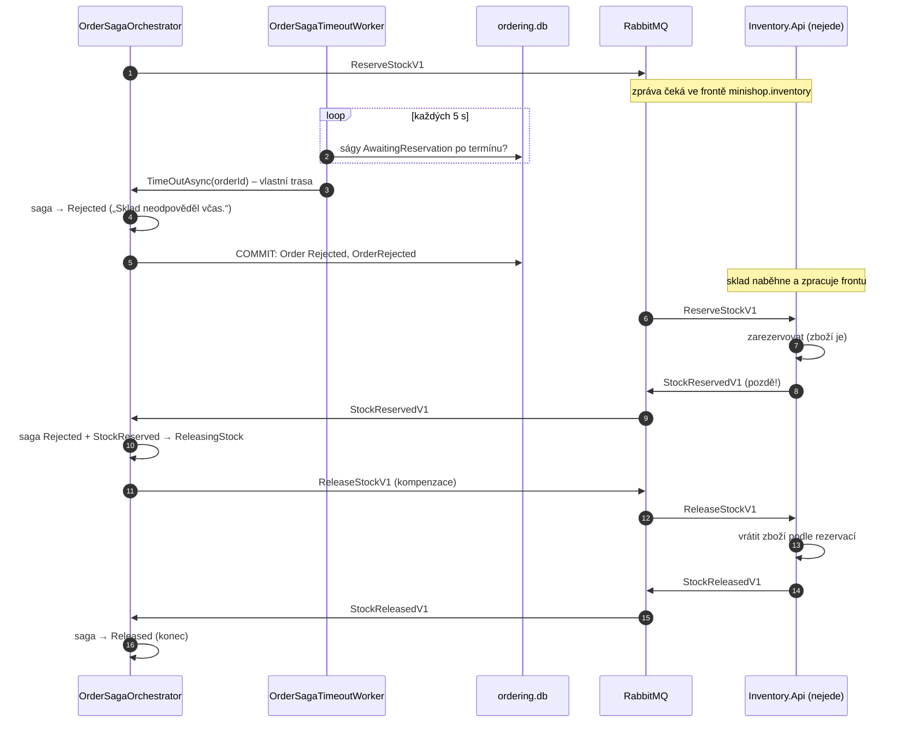

> **Shrnutí:** Objednávka nesmí viset věčně. Když sklad neodpoví do `Sagas:ReservationTimeoutSeconds` (30 s),
> hlídač ji zamítne. Pokud sklad mezitím zboží přece jen zarezervoval, sága pošle `ReleaseStockV1` – **kompenzace**.

## Scénář: sklad byl chvíli mimo provoz

## Co si všimnout

- **Zprávy se neztratí** – i když sklad neběží, příkaz čeká ve frontě RabbitMQ.
- **Objednávka se nevrací do hry.** Zamítnutí platí; pozdní rezervace se jen napraví vrácením zboží.
- **Souběh timeoutu a odpovědi**: když přijdou současně, sága má *concurrency token* (`Version`) – jeden zápis
  vyhraje, druhý se zopakuje nad novým stavem a zjistí, že už nemá co dělat.
- Timeout začíná **novou trasu** – v dashboardu není pod původním požadavkem (nevyvolal ho uživatel).

## Vyzkoušejte

1. Spusťte aplikaci, zastavte `inventory-api` (v Aspire dashboardu tlačítkem *Stop*).
2. Vytvořte objednávku → po ~30 s je `Rejected` („Sklad neodpověděl včas.“).
3. Spusťte sklad znovu → v auditním logu uvidíte `StockReservedV1`, pak `ReleaseStockV1` a `StockReleasedV1`.

## Kód

[OrderSagaTimeoutWorker](code:src/MiniShop.Web/BackgroundServices/OrderSagaTimeoutWorker.cs) ·
[OrderSaga](code:src/MiniShop.Domain/Orders/Saga/OrderSaga.cs) ·
[ReleaseStockHandler](code:src/MiniShop.Application/Inventory/ReleaseStockHandler.cs) ·
[testy ságy](code:tests/MiniShop.Tests/Domain/OrderSagaTests.cs)
