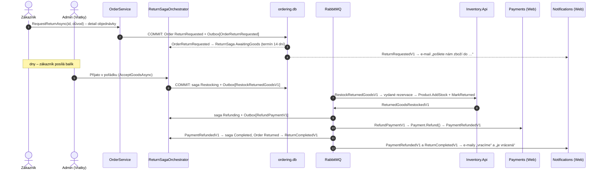

> **Shrnutí:** Zákazník může doručenou objednávku vrátit do 14 dní (`Returns:WindowDays`), celou a jen jednou.
> Proces trvá dny a jde přes tři účastníky. Řídí ho **druhá sága** `ReturnSaga` s orchestrátorem
> `ReturnSagaOrchestrator` (Ordering): admin převezme zásilku → sklad naskladní (`RestockReturnedGoodsV1`) →
> kartou Payments vrátí peníze (stávající `RefundPaymentV1`). Dobírku vrací admin ručně převodem.

Přirovnání: reklamace v obchodě. Na pultu dostaneš lístek (žádost), zboží odneseš na sklad, a teprve když ho skladník
převezme v pořádku, pokladna ti vrátí peníze. Když ho přineseš rozbité, žádost zamítnou.

## Tok – platba kartou

**Dobírka:** po `ReturnedGoodsRestockedV1` sága rovnou skončí (`CompleteReturn`). Modul Payments peníze nikdy
nepřijal, takže je vrátit neumí. `ReturnCompletedV1` nese `RefundedByCard = false` a e-mail i stránka Vratky
říkají „peníze převodem“.

## Zamítnutí a vypršení

| Co se stane | Kdo | Výsledek |
| --- | --- | --- |
| Zboží dorazilo poškozené | admin **Zamítnout** (s důvodem) | sága `Rejected`, objednávka zpět `Completed` + `ReturnRejectedV1` → e-mail s důvodem |
| Zboží nedorazilo do termínu | `OrderSagaTimeoutWorker` (jako timeouty objednávky) | sága `Expired`, objednávka zpět `Completed` (`ReturnSaga.ExpiredReason`) |
| Zásilka dorazí po vypršení | admin **Přijato** | nic – sága už na zboží nečeká (`GoodsReceived` → `None`), stránka to oznámí |

Vrátit jde objednávku **jen jednou**. Po zamítnutí nebo vypršení tlačítko **Vrátit zboží** zmizí
(`Order.CanRequestReturn` hledá v historii stav `ReturnRequested`).

## Co si všimnout

- **Krok člověka uprostřed ságy.** Na admina sága čeká stejně jako na zprávu – jen s termínem ve dnech. Stránka Vratky
  volá orchestrátor přímo (jako timeout worker), sága rozhodne, jestli je převzetí ještě platné.
- **Sklad vrací podle svých rezervací.** `RestockReturnedGoodsHandler` naskladní jen vydané a ještě nevrácené
  rezervace (`StockReservation.ReturnedAtUtc`). Opakovaný příkaz naskladní 0 kusů a jen znovu odpoví – nic se nezdvojí.
- **Payments se nezměnil.** Vratka používá stejný příkaz `RefundPaymentV1` jako pozdní platba. `PaymentRefundedV1`
  poslouchá i orchestrátor vratky – bez ságy vratky (pozdní platba, zrušení) ji ignoruje.
- **Souběh admin × timeout** hlídá `ReturnSaga.Version` (concurrency token) – projde jen jeden zápis.
- **Přehled tržeb** (Reporting) dostane `ReturnCompletedV1` a vrácenou objednávku z tržby odečte – ani o tom Ordering neví.
- Rozpracovaná vratka blokuje smazání účtu (`Order.IsActive`).

## Kód

[Order](code:src/MiniShop.Domain/Orders/Order.cs) ·
[ReturnSaga](code:src/MiniShop.Domain/Orders/Saga/ReturnSaga.cs) ·
[ReturnSagaOrchestrator](code:src/MiniShop.Application/Ordering/Saga/ReturnSagaOrchestrator.cs) ·
[RestockReturnedGoodsHandler](code:src/MiniShop.Application/Inventory/RestockReturnedGoodsHandler.cs) ·
[Stránka Vratky](code:src/MiniShop.Web/Pages/Admin/Returns/Index.cshtml.cs) ·
[ReturnRequestedV1](code:src/MiniShop.Contracts/Orders/ReturnRequestedV1.cs) ·
[ReturnRejectedV1](code:src/MiniShop.Contracts/Orders/ReturnRejectedV1.cs) ·
[ReturnCompletedV1](code:src/MiniShop.Contracts/Orders/ReturnCompletedV1.cs) ·
[RestockReturnedGoodsV1](code:src/MiniShop.Contracts/Inventory/RestockReturnedGoodsV1.cs) ·
[ReturnedGoodsRestockedV1](code:src/MiniShop.Contracts/Inventory/ReturnedGoodsRestockedV1.cs)
