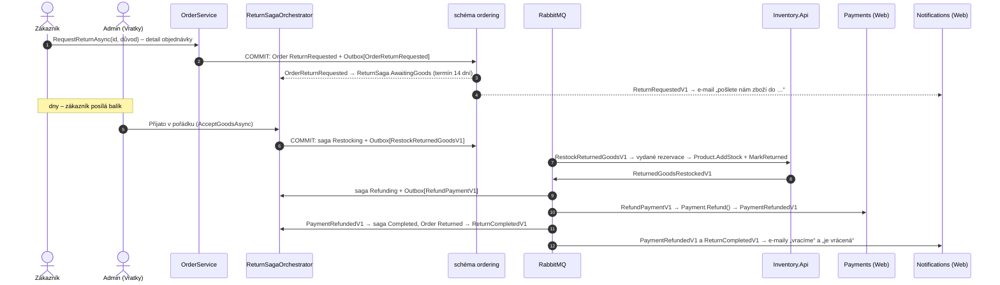
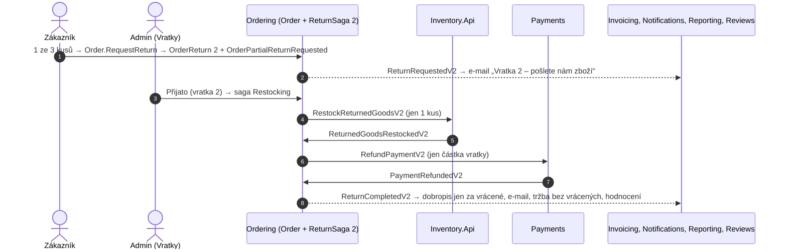

> **Shrnutí:** Zákazník může doručenou objednávku vrátit do 14 dní (`Returns:WindowDays`) – celou najednou, nebo od e-shop
> kroku 22 **po částech** (vybrané kusy, víc vratek po sobě).
> Proces trvá dny a jde přes tři účastníky. Řídí ho **druhá sága** `ReturnSaga` s orchestrátorem
> `ReturnSagaOrchestrator` (Ordering): admin převezme zásilku → sklad naskladní (`RestockReturnedGoodsV1`) →
> kartou Payments vrátí peníze (stávající `RefundPaymentV1`). Dobírku vrací admin ručně převodem.

Přirovnání: reklamace v obchodě. Na pultu dostaneš lístek (žádost), zboží odneseš na sklad, a teprve když ho skladník
převezme v pořádku, pokladna ti vrátí peníze. Když ho přineseš rozbité, žádost zamítnou.

## Tok – platba kartou

**Dobírka:** po `ReturnedGoodsRestockedV1` sága rovnou skončí (`CompleteReturn`). Modul Payments peníze nikdy
nepřijal, takže je vrátit neumí. `ReturnCompletedV1` nese `RefundedByCard = false` a e-mail i stránka Vratky
říkají „peníze převodem“.

## Zamítnutí a vypršení

| Co se stane | Kdo | Výsledek |
| --- | --- | --- |
| Zboží dorazilo poškozené | admin **Zamítnout** (s důvodem) | sága `Rejected`, objednávka zpět `Completed` + `ReturnRejectedV1` → e-mail s důvodem |
| Zboží nedorazilo do termínu | `OrderSagaTimeoutWorker` (jako timeouty objednávky) | sága `Expired`, objednávka zpět `Completed` (`ReturnSaga.ExpiredReason`) |
| Zásilka dorazí po vypršení | admin **Přijato** | nic – sága už na zboží nečeká (`GoodsReceived` → `None`), stránka to oznámí |

Vratku **celé objednávky** jde udělat jen jednou a jen jako první. Po jejím zamítnutí nebo vypršení tlačítko
**Vrátit zboží** zmizí (`Order.CanRequestReturn` hledá v historii stav `ReturnRequested`).

## Vratka po částech (e-shop krok 22)

Zákazník ve formuláři na detailu objednávky vybere **počet kusů** u každé položky (výchozí = všechno, co jde ještě vrátit).
Vybere-li jako první vratku všechno, jde o vratku celé objednávky (tok výše, vrací se i doprava). Jinak vznikne
**vratka po částech** – `OrderReturn` v agregátu `Order` s číslem 1, 2, … – a objednávka **zůstává doručená**.

| Pravidlo | Kde |
| --- | --- |
| kusy produktu ≤ koupené − vrácené − právě vracené (zamítnutá vratka se nepočítá) | `Order.ReturnableQuantity` |
| nejvýš **jedna rozpracovaná** vratka najednou | `Order.OpenReturn` |
| do 14 dní od doručení, ne po vratce celé objednávky (ani zamítnuté) | `Order.CanRequestPartialReturn` |
| podíl slevy z kuponu poměrně na kusy, poslední kusy dostanou zbytek (součet sedí na haléř) | `Order.RequestReturn` |
| **doprava se nevrací** – ani když zákazník postupně vrátí všechno; vratka celé objednávky po vratce po částech už nejde | `Order.CanRequestReturn` |
| zamítnutí / vypršení = jen tahle vratka (`ReturnRejectedV2`), kusy jde vrátit znovu další vratkou | `Order.RejectPartialReturn` |

Sága vratky má klíč **objednávka + číslo vratky** (0 = celá objednávka – i všechny ságy z doby před krokem 22). Stránka
Vratky ukazuje řádek na vratku s vracenými kusy a částkou; Přijato/Zamítnout posílá i číslo vratky. Dobírka: po naskladnění
rovnou konec, peníze převodem. Přestavění přehledu tržeb dostane vyřízené vratky ve snímku `OrderPartialReturnsSnapshotV1`.

## Co si všimnout

- **Krok člověka uprostřed ságy.** Na admina sága čeká stejně jako na zprávu – jen s termínem ve dnech. Stránka Vratky
  volá orchestrátor přímo (jako timeout worker), sága rozhodne, jestli je převzetí ještě platné.
- **Sklad vrací podle svých rezervací.** `RestockReturnedGoodsHandler` naskladní jen vydané a ještě nevrácené
  rezervace (`StockReservation.ReturnedAtUtc`). Opakovaný příkaz naskladní 0 kusů a jen znovu odpoví – nic se nezdvojí.
- **Payments se nezměnil.** Vratka používá stejný příkaz `RefundPaymentV1` jako pozdní platba. `PaymentRefundedV1`
  poslouchá i orchestrátor vratky – bez ságy vratky (pozdní platba, zrušení) ji ignoruje.
- **Souběh admin × timeout** hlídá `ReturnSaga.Version` (concurrency token) – projde jen jeden zápis.
- **Přehled tržeb** (Reporting) dostane `ReturnCompletedV1` a vrácenou objednávku z tržby odečte – ani o tom Ordering neví.
- Rozpracovaná vratka blokuje smazání účtu (`Order.IsActive`).

**Jak se vratka po částech zaváděla (e-shop krok 22):** „od konce“ – nejdřív se nové zprávy naučí příjemci, až nakonec
je začne posílat Ordering (žádný mezistav, kdy by vratka po částech vrátila celou platbu nebo vystavila celý dobropis):

| Část | Stav | Co umí |
| --- | --- | --- |
| 22A – sklad a Payments | hotovo | `RestockReturnedGoodsV2` (jen uvedené kusy, každá vratka jednou – `StockReturn`) → `ReturnedGoodsRestockedV2`; `RefundPaymentV2` (jen částka vratky, součet ≤ zaplaceno, Stripe `amount`) → `PaymentRefundedV2` |
| 22B – dobropisy, e-maily, tržby, hodnocení | hotovo | `ReturnRequestedV2` / `ReturnRejectedV2` / `ReturnCompletedV2` (položky `ReturnItemV1`): dobropis jen s vrácenými řádky (víc dobropisů na fakturu, součet ≤ faktura), e-maily se seznamem položek, tržba bez vrácené částky, hodnocení blokuje jen produkt vrácený celý |
| 22C – Ordering a obrazovky | hotovo | `OrderReturn`, formulář s počty kusů, sága pro každou vratku (klíč objednávka + číslo), odesílání V2, `OrderPartialReturnsSnapshotV1` pro přestavění tržeb |

**Dobropis (e-shop krok 15B):** `ReturnCompletedV1` poslouchá i modul Invoicing – k faktuře vystaví dobropis
(„Vráceno na kartu“, u dobírky „Vrátíme převodem na účet“) a zákazník ho dostane e-mailem v PDF
([Vystavení faktury a dobropisu](faktura.md)).

## Kód

[Order](code:src/MiniShop.Domain/Orders/Order.cs) ·
[OrderReturn](code:src/MiniShop.Domain/Orders/OrderReturn.cs) ·
[ReturnRequestedV2](code:src/MiniShop.Contracts/Orders/ReturnRequestedV2.cs) ·
[ReturnCompletedV2](code:src/MiniShop.Contracts/Orders/ReturnCompletedV2.cs) ·
[OrderPartialReturnsSnapshotV1](code:src/MiniShop.Contracts/Orders/OrderPartialReturnsSnapshotV1.cs) ·
[ReturnSaga](code:src/MiniShop.Domain/Orders/Saga/ReturnSaga.cs) ·
[ReturnSagaOrchestrator](code:src/MiniShop.Application/Ordering/Saga/ReturnSagaOrchestrator.cs) ·
[RestockReturnedGoodsHandler](code:src/MiniShop.Application/Inventory/RestockReturnedGoodsHandler.cs) ·
[Stránka Vratky](code:src/MiniShop.Web/Pages/Admin/Returns/Index.cshtml.cs) ·
[ReturnRequestedV1](code:src/MiniShop.Contracts/Orders/ReturnRequestedV1.cs) ·
[ReturnRejectedV1](code:src/MiniShop.Contracts/Orders/ReturnRejectedV1.cs) ·
[ReturnCompletedV1](code:src/MiniShop.Contracts/Orders/ReturnCompletedV1.cs) ·
[RestockReturnedGoodsV1](code:src/MiniShop.Contracts/Inventory/RestockReturnedGoodsV1.cs) ·
[ReturnedGoodsRestockedV1](code:src/MiniShop.Contracts/Inventory/ReturnedGoodsRestockedV1.cs)
