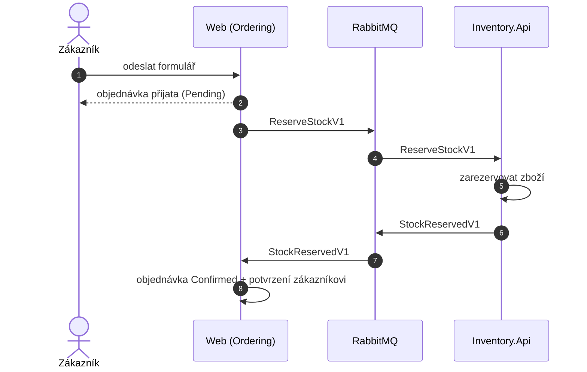
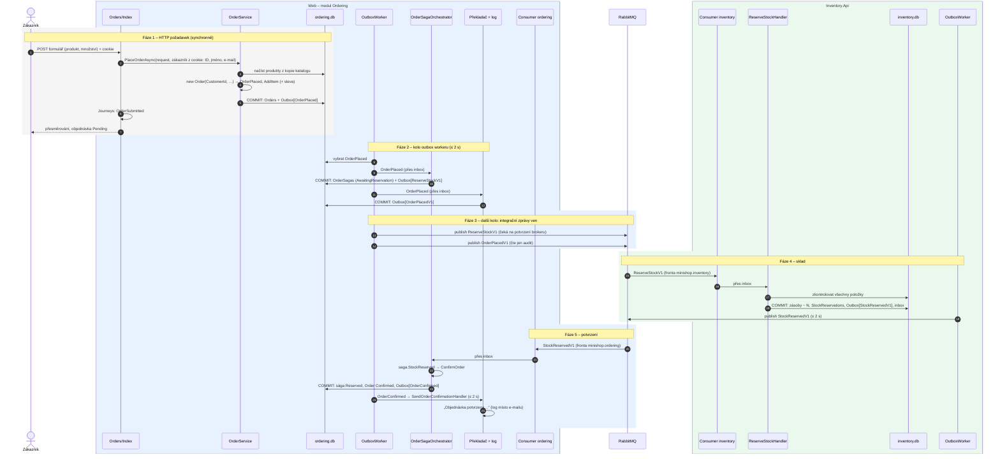

> **Shrnutí:** Web objednávku uloží jako `Pending` a hned odpoví. Na pozadí sága pošle skladu příkaz
> `ReserveStockV1`, sklad zboží zarezervuje a odpoví `StockReservedV1`, sága objednávku potvrdí a zákazník
> dostane potvrzení. Celé to trvá **~4–8 s**.

## Zjednodušeně

## Podrobně

## Co si všimnout

- **Kroky 1–7 jsou jediné synchronní.** Zákazník nečeká na sklad – dostane `Pending` a stránka se sama obnoví
  (jen když zrovna nic nevyplňuje).
- **Každý `COMMIT` je jedna lokální transakce** v jedné databázi. Mezi databázemi putují jen zprávy.
- **Mezi fázemi jsou časové mezery** (kolo workeru 2 s, doručení přes RabbitMQ). Proto potvrzení trvá několik sekund.
- **Každé převzetí zprávy jde přes inbox** – kdyby se cokoli doručilo dvakrát, nic se nezdvojí.
- Zprávu `OrderPlacedV1` zatím nikdo nezpracovává (jen auditní log). Je připravená pro budoucí odběratele
  (např. věrnostní program) – ti se přidají **bez změny Orderingu**.

## Kód

[Orders/Index.cshtml.cs](code:src/MiniShop.Web/Pages/Orders/Index.cshtml.cs) ·
[OrderService](code:src/MiniShop.Application/Ordering/OrderService.cs) ·
[OrderSagaOrchestrator](code:src/MiniShop.Application/Ordering/Saga/OrderSagaOrchestrator.cs) ·
[ReserveStockHandler](code:src/MiniShop.Application/Inventory/ReserveStockHandler.cs) ·
[test celé cesty](code:tests/MiniShop.Tests/Application/OrderServiceTests.cs)

## Související

- Co když zboží nestačí: [Zamítnutí objednávky](zamitnuti-objednavky.md)
- Co když sklad mlčí: [Timeout a kompenzace](timeout-a-kompenzace.md)
- Detail jedné zprávy: [Cesta jedné zprávy](cesta-zpravy.md)
