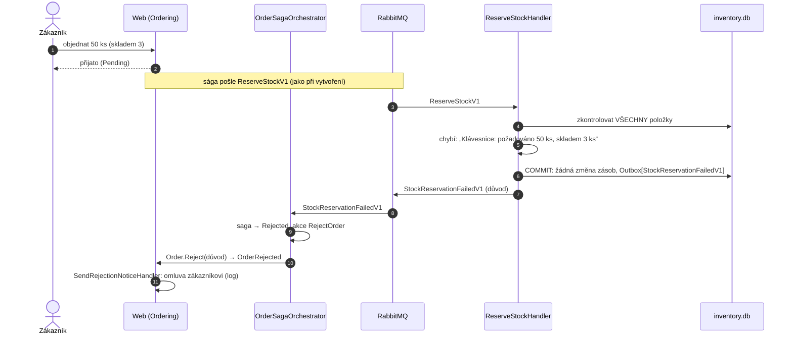

> **Shrnutí:** Nedostatek zboží není chyba požadavku (HTTP 400), ale **business výsledek**. Sklad zkontroluje
> všechny položky, a když některá nestačí, nezarezervuje **nic** a odpoví `StockReservationFailedV1` s důvodem.

## Co si všimnout

- **Všechno, nebo nic.** Sklad nejdřív zkontroluje všechny položky a teprve pak odečítá. Nikdy nezarezervuje půlku
  objednávky – nebylo by co kompenzovat.
- **Důvod putuje až k zákazníkovi** – v UI je u zamítnuté objednávky vidět, které zboží chybělo.
- Kontrola zásoby ve formuláři (údaj ze skladu přes HTTP) je jen **orientační**. Rozhoduje až rezervace – mezi
  zobrazením formuláře a objednáním mohl zboží koupit někdo jiný.

## Kód

[ReserveStockHandler](code:src/MiniShop.Application/Inventory/ReserveStockHandler.cs) ·
[OrderSaga.StockReservationFailed](code:src/MiniShop.Domain/Orders/Saga/OrderSaga.cs) ·
[SendRejectionNoticeHandler](code:src/MiniShop.Application/Ordering/EventHandlers/SendRejectionNoticeHandler.cs)
