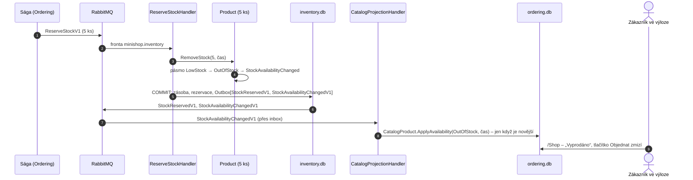

> **Shrnutí:** Sklad nehlásí každý prodaný kus – jen přechod do jiného **pásma dostupnosti**. Rezervace v sáze, uvolnění
> (kompenzace) i naskladnění zavolají na produktu `RemoveStock`/`AddStock`; když se změní pásmo, vznikne
> `StockAvailabilityChanged` → `StockAvailabilityChangedV1` a výloha ukáže novou cedulku.

## Vyprodání rezervací posledních kusů

Zrušení objednávky vrátí zboží (kompenzace `ReleaseStockV1` → `AddStock`) a produkt se přes stejnou zprávu vrátí
do pásma „Poslední kusy“.

## Co si všimnout

- **Událost podle potřeby příjemce:** prodej jednoho z 40 kusů zprávu nevyvolá (pořád „Skladem“). Zpráv je málo
  a výloha nezná číslo, které jí nepatří.
- **Vlastní čas dostupnosti** (`Product.AvailabilityChangedAtUtc`, v kopii `AvailabilityChangedAtUtc`) – nezávislý na
  čase změny produktu. Pozdní zpráva o dostupnosti nepřepíše novější stav a změna ceny nepřepíše dostupnost.
- **Zpráva pro produkt, který kopie ještě nezná,** se zahodí – `ProductUpdatedV2` nese dostupnost jako snímek,
  takže ji nový produkt dostane s ní.
- **Výloha může být pár sekund pozadu.** Rozhoduje rezervace: produkt „Skladem“ může skončit zamítnutím, když
  poslední kus koupil někdo o vteřinu dřív.

## Kód

[Product](code:src/MiniShop.Domain/Inventory/Product.cs) ·
[StockAvailability](code:src/MiniShop.Domain/Inventory/StockAvailability.cs) ·
[StockAvailabilityChanged](code:src/MiniShop.Domain/Inventory/Events/StockAvailabilityChanged.cs) ·
[InventoryDbContext](code:src/MiniShop.Infrastructure/Inventory/InventoryDbContext.cs) ·
[CatalogProjectionHandler](code:src/MiniShop.Application/Ordering/Catalog/CatalogProjectionHandler.cs) ·
[CatalogProduct](code:src/MiniShop.Domain/Orders/CatalogProduct.cs)
