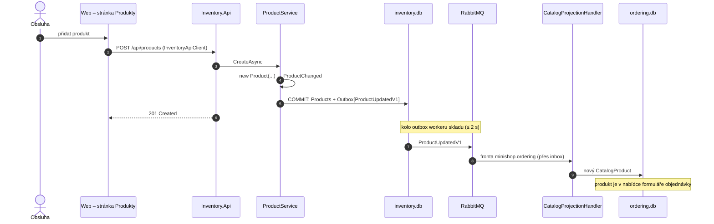

> **Shrnutí:** Založení nebo změna produktu (název, cena) vyvolá `ProductChanged`, která se rovnou při uložení přeloží
> na `ProductUpdatedV1`. Ordering si podle ní přepíše svou kopii – pokud změna není starší než to, co už zná.

## Nový produkt ze stránky Produkty

## Změna ceny nebo názvu

UI Webu změnu produktu nenabízí; jde přes REST API skladu `PUT /api/products/{id}` (např. ze souboru
`MiniShop.Web.http`). Tok je stejný – jen místo `new Product` proběhne `product.Update(...)` a projekce
zavolá `CatalogProduct.Apply`, která **starší změnu ignoruje** (zprávy můžou přijít v jiném pořadí).

## Co si všimnout

- **Stránka Produkty je ve Webu, ale data patří skladu** – UI volá Inventory.Api přes HTTP. Business důsledek
  (kopie katalogu) ale jde přes zprávu.
- **Naskladnění zprávu nevyvolá** – Ordering zásobu nepotřebuje.
- **Smazání** pošle `ProductRemovedV1` a kopie produkt jen označí jako odebraný.
- Objednávky, které už existují, si nesou **snímek** ceny z doby objednání – změna je neovlivní.

## Kód

[ProductService](code:src/MiniShop.Application/Inventory/ProductService.cs) ·
[Product](code:src/MiniShop.Domain/Inventory/Product.cs) ·
[InventoryDbContext](code:src/MiniShop.Infrastructure/Inventory/InventoryDbContext.cs) ·
[CatalogProjectionHandler](code:src/MiniShop.Application/Ordering/Catalog/CatalogProjectionHandler.cs) ·
[CatalogProduct](code:src/MiniShop.Domain/Orders/CatalogProduct.cs)
