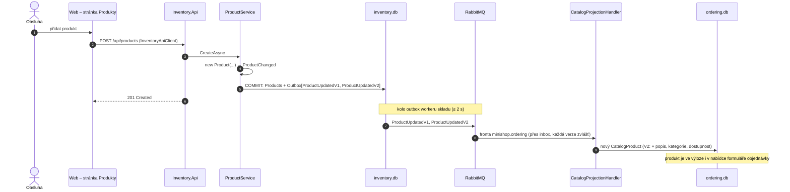

> **Shrnutí:** Založení nebo změna produktu (název, popis, cena, kategorie) vyvolá `ProductChanged`, která se rovnou
> při uložení přeloží na `ProductUpdatedV1` a `ProductUpdatedV2` (e-shop krok 2: obě verze vedle sebe). Ordering si podle
> nich přepíše svou kopii – pokud změna není starší než to, co už zná.

## Nový produkt ze stránky Produkty

## Změna produktu nebo kategorie

E-shop krok 2: admin produkt upraví na stránce [Úprava produktu](code:src/MiniShop.Web/Pages/Products/Edit.cshtml.cs)
(nebo přes REST API skladu `PUT /api/products/{id}`). Tok je stejný – jen místo `new Product` proběhne
`product.Update(...)` a projekce zavolá `CatalogProduct.Apply` / `ApplyDetails`, které **starší změnu ignorují**
(zprávy můžou přijít v jiném pořadí).

**Přejmenování kategorie** ([CategoryService](code:src/MiniShop.Application/Inventory/CategoryService.cs)) zavolá
`product.CategoryRenamed` u každého produktu kategorie – jméno kategorie je součástí zprávy o produktu, takže se ho
výloha dozví od produktů. Kategorie sama žádnou zprávu nemá.

## Co si všimnout

- **Stránka Produkty je ve Webu, ale data patří skladu** – UI volá Inventory.Api přes HTTP. Business důsledek
  (kopie katalogu) ale jde přes zprávu.
- **Naskladnění** pošle zprávu, jen když produkt přejde do jiného pásma dostupnosti – viz
  [Změna dostupnosti](zmena-dostupnosti.md).
- **Smazání** pošle `ProductRemovedV1` a kopie produkt jen označí jako odebraný.
- Objednávky, které už existují, si nesou **snímek** ceny z doby objednání – změna je neovlivní.

## Kód

[ProductService](code:src/MiniShop.Application/Inventory/ProductService.cs) ·
[Product](code:src/MiniShop.Domain/Inventory/Product.cs) ·
[InventoryDbContext](code:src/MiniShop.Infrastructure/Inventory/InventoryDbContext.cs) ·
[CatalogProjectionHandler](code:src/MiniShop.Application/Ordering/Catalog/CatalogProjectionHandler.cs) ·
[CatalogProduct](code:src/MiniShop.Domain/Orders/CatalogProduct.cs)
