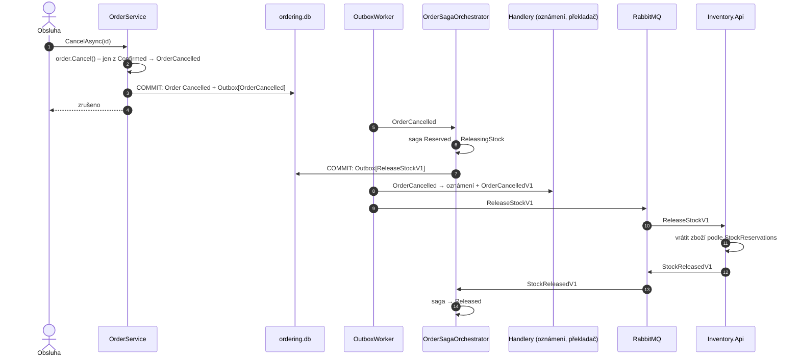
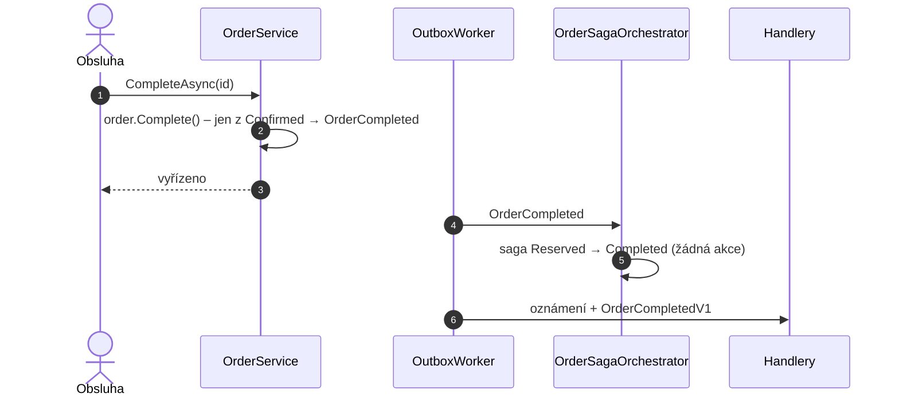

> **Shrnutí:** Obsluha u potvrzené objednávky klikne na *Vyřídit* nebo *Zrušit*. Vyřízení ságu jen uzavře
> (zboží zůstává prodané). Zrušení spustí **kompenzaci** – příkaz `ReleaseStockV1`.

## Zrušení

## Vyřízení

## Co si všimnout

- `OrderService.CancelAsync` **o skladu neví** – jen změní stav. Vrácení zboží je reakce ságy na událost.
- Sklad vrací zboží podle **svých rezervací**, ne podle položek objednávky – pracuje jen s tím, co sám zná.
- Zrušit jde jen potvrzenou objednávku; `Pending` čeká na rozhodnutí ságy (pravidlo hlídá entita `Order`).

## Kód

[OrderService](code:src/MiniShop.Application/Ordering/OrderService.cs) ·
[Order](code:src/MiniShop.Domain/Orders/Order.cs) ·
[ReleaseStockHandler](code:src/MiniShop.Application/Inventory/ReleaseStockHandler.cs)
