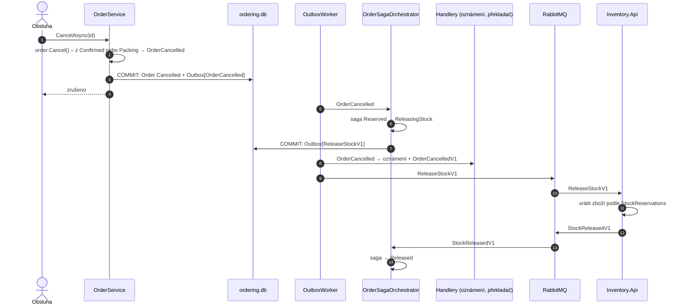

> **Shrnutí:** Zákazník (nebo admin) zruší potvrzenou objednávku – od e-shop kroku 6 i během balení, po odeslání
> už ne. Zrušení spustí **kompenzaci** – příkaz `ReleaseStockV1`. Balení, odeslání a doručení (dřív „Vyřídit“)
> popisuje [Expedice](expedice.md).

## Zrušení

## Co si všimnout

- `OrderService.CancelAsync` **o skladu neví** – jen změní stav. Vrácení zboží je reakce ságy na událost.
- Sklad vrací zboží podle **svých rezervací**, ne podle položek objednávky – pracuje jen s tím, co sám zná.
- Zrušit jde potvrzenou nebo balenou objednávku; `Pending` čeká na rozhodnutí ságy, `Shipped` je už na cestě
  (pravidlo hlídá entita `Order`). Souběh se současným odesláním řeší `Order.Version` – viz [Expedice](expedice.md).

## Kód

[OrderService](code:src/MiniShop.Application/Ordering/OrderService.cs) ·
[Order](code:src/MiniShop.Domain/Orders/Order.cs) ·
[ReleaseStockHandler](code:src/MiniShop.Application/Inventory/ReleaseStockHandler.cs)
