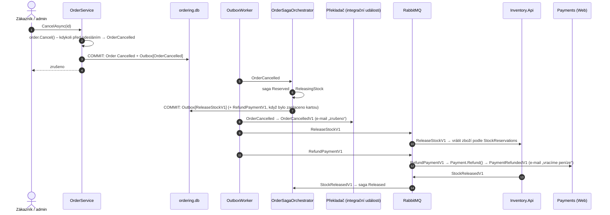
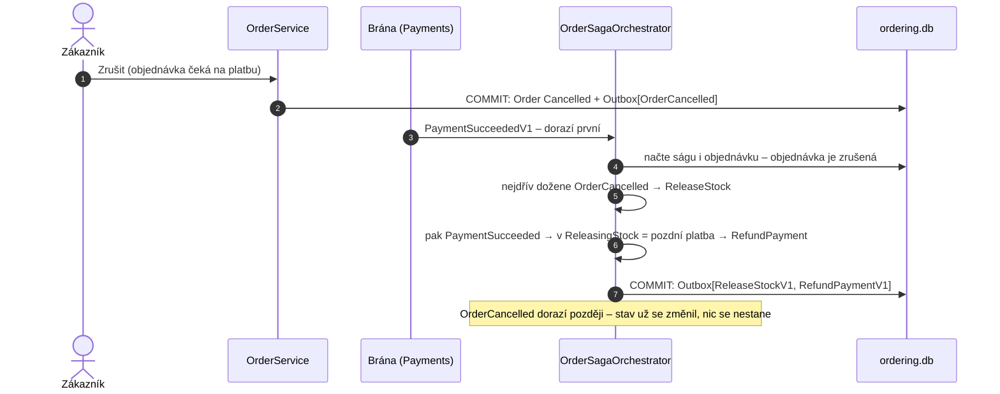

> **Shrnutí:** Zákazník (nebo admin) zruší objednávku kdykoli **před odesláním** – od e-shop kroku 9 i když
> ještě čeká na sklad (`Pending`) nebo na platbu (`AwaitingPayment`). `OrderService` jen změní stav; co je
> potřeba vrátit, zařídí [sága](../eda/saga.md) **kompenzací**: `ReleaseStockV1` (zboží) a u zaplacené
> objednávky `RefundPaymentV1` (peníze). Balení, odeslání a doručení popisuje [Expedice](expedice.md).

## Zrušení potvrzené objednávky

## Zrušení dřív, než sklad nebo brána odpoví (e-shop krok 9)

Odpověď může být „na cestě“: sklad už zboží možná rezervuje, zákazník možná zrovna platí. Zrušení proto nejde
hned vrátit – sága si ho **zapíše** a pozdní odpověď **dožene**. Jako v restauraci: zrušíte objednávku, kuchař
už možná vaří – číšník si to poznamená, a když jídlo přece jen přinese, vrátí ho do kuchyně.

| Sága při zrušení | Co udělá hned | Pozdní zpráva | Reakce |
| --- | --- | --- | --- |
| `AwaitingReservation` | stav `Cancelled`, nic nevrací | `StockReservedV1` | `ReleaseStockV1` |
| | | `StockReservationFailedV1`, timeout | nic (není co vracet) |
| `AwaitingPayment` | `ReleaseStockV1` | `PaymentSucceededV1` | `RefundPaymentV1` (jen jednou) |
| `Reserved` + zaplaceno kartou | `ReleaseStockV1` + `RefundPaymentV1` | další `PaymentSucceededV1` | nic |
| `Reserved` + dobírka | `ReleaseStockV1` | — | — |

Stejný vzor MiniShop už měl pro rezervaci, která dorazí po timeoutu – viz [Timeout a kompenzace](timeout-a-kompenzace.md).

### Odpověď předběhla zrušení

Událost `OrderCancelled` jde přes outbox, takže k ságe může dorazit **později** než odpověď skladu nebo brány:

Bez toho by sága zkusila potvrdit zrušenou objednávku. Kdyby zákazník zrušil přesně mezi tím, co sága objednávku
načetla a uložila, uložení ságy narazí na `Order.Version` (`ConcurrencyConflictException`), zpráva se zopakuje
a napodruhé už sága zrušení uvidí. Naopak když dřív uloží sága, zákazník dostane „Objednávka se mezitím změnila“.

## Co si všimnout

- `OrderService.CancelAsync` **o skladu ani platbě neví** – jen změní stav. Vrácení je reakce ságy na událost.
- Sklad vrací zboží podle **svých rezervací**, ne podle položek objednávky – pracuje jen s tím, co sám zná.
- Zrušit jde `Pending`, `AwaitingPayment`, `Confirmed` a `Packing`; `Shipped` je už na cestě, `Rejected` a
  `Completed` jsou konečné (pravidlo hlídá entita `Order`). Souběh se současným odesláním řeší `Order.Version` –
  viz [Expedice](expedice.md).
- Stránka brány `/Pay/{id}` u zrušené objednávky platit nedovolí. Kdyby platba přesto prošla (skutečná brána,
  webhook na cestě), peníze vrátí sága – žádný nový příkaz „zruš platbu“ není potřeba.
- E-maily jsou dva samostatné: „zrušeno“ (`OrderCancelledV1`) a „vracíme peníze“ (`PaymentRefundedV1`) – Ordering
  kvůli nim nic neposílá, oba píše [Notifications](../architektura/moduly/notifications.md).

## Kód

[OrderService](code:src/MiniShop.Application/Ordering/OrderService.cs) ·
[Order](code:src/MiniShop.Domain/Orders/Order.cs) ·
[OrderSaga](code:src/MiniShop.Domain/Orders/Saga/OrderSaga.cs) ·
[OrderSagaOrchestrator](code:src/MiniShop.Application/Ordering/Saga/OrderSagaOrchestrator.cs) ·
[ReleaseStockHandler](code:src/MiniShop.Application/Inventory/ReleaseStockHandler.cs) ·
[PaymentCommandHandlers](code:src/MiniShop.Application/Payments/PaymentCommandHandlers.cs)
