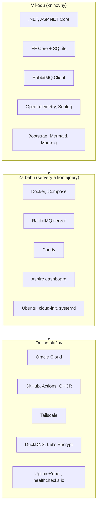

> **V jedné větě:** MiniShop stojí na open-source knihovnách .NET, na kontejnerových nástrojích a na několika
> bezplatných online službách. Každá položka katalogu říká, **co to je**, **proč ji používáme** a **kde je v projektu**.

## Kde co je

| Stránka | Obsah |
| --- | --- |
| [Knihovny a frameworky](knihovny.md) | .NET, NuGet balíčky, front-end knihovny – i s verzemi z běžící aplikace |
| [Běhové prostředí](beh.md) | Docker, RabbitMQ, Caddy, Aspire dashboard, Ubuntu, systemd… |
| [Online služby](sluzby.md) | Oracle Cloud, GitHub, Tailscale, DuckDNS, Let's Encrypt, monitoring |

## Jak se volí nová závislost

1. **Je opravdu potřeba?** Každá závislost je kód, který neznáme a musíme aktualizovat.
2. **Zdarma a open-source** (nebo free tarif bez časového omezení) – rozpočet je 0 Kč.
3. **Rozšířená a udržovaná** – aktivní vývoj, dokumentace, komunita.
4. **Přidat ji sem do katalogu** – test `DocumentationTests` jinak neprojde.
5. Aktualizace hlídá **Dependabot** ([Repozitář](../github/repozitar.md)).
